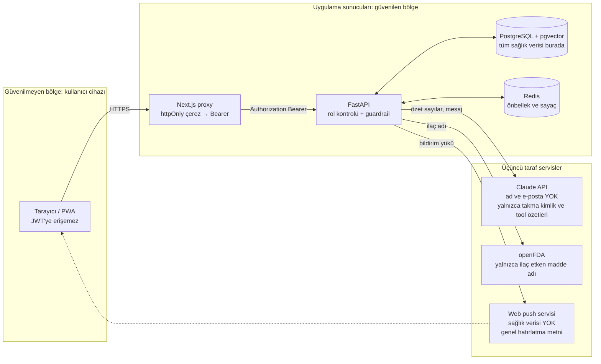

# Veri Gizliliği Yaklaşımı

Platform özel nitelikli kişisel veri (sağlık verisi) işler. Yaklaşım KVKK'nın sağlık verisine ilişkin ilkelerini ve "privacy by design" ilkesini temel alır.

## 1. İlkeler

| İlke | Uygulama |
|---|---|
| Veri minimizasyonu | TC kimlik no, adres, telefon toplanmaz. Hasta için yalnızca ad, e-posta, doğum yılı, hastalık türü tutulur. |
| Amaçla sınırlılık | Veri yalnızca uyum takibi ve hekim bilgilendirmesi için kullanılır; reklam/analitik üçüncü taraf yok. |
| Açık rıza | Kayıtta ayrı onay: (a) verinin hekimle paylaşılması, (b) mesajların LLM ile işlenmesi, (c) bakım veren eklenmesi. |
| Erişim kontrolü | Rol bazlı yetki (aşağıda), tüm yetki kontrolleri backend'de yapılır. |
| Silme hakkı | Hasta hesabını sildiğinde kişisel veriler silinir, istatistik için yalnızca anonim toplamlar kalır. |

## 2. Rol bazlı erişim matrisi

| Kaynak | Hasta | Hekim | Bakım veren |
|---|---|---|---|
| Kendi profil | Oku/Yaz | — | — |
| İlaç planı | Oku/Yaz (kendi) | Oku (atanmış hastalar) | Oku (bağlı hasta) |
| Doz kayıtları | Oku/Yaz (kendi) | Oku | Oku |
| Ölçümler | Oku/Yaz (kendi) | Oku | Oku |
| Koç mesajları | Oku/Yaz (kendi) | Yalnızca risk bayraklı mesajlar | — |
| Uyarılar (alerts) | Oku | Oku / Kapat | Oku |
| Haftalık özet | Oku | Oku | Oku |

Yetkisiz erişimde kaynak varlığını sızdırmamak için **404** döner.

## 3. LLM'e giden veri

- Hastanın adı, e-postası ve kimlik bilgisi **gönderilmez**; koç yalnızca takma kimlik (`patient_ref`) ve tool çağrısıyla dönen sayısal özetleri görür.
- Tool'lar yalnızca o oturumdaki hastanın verisine erişebilir (hasta kimliği sunucu tarafında bağlanır, model parametre olarak veremez).
- Sağlayıcı tarafında veri saklama/eğitime kullanma kapalı API ayarları tercih edilir; README'de belirtilir.

## Veri akışları ve güven sınırları

## 4. Teknik önlemler

- Şifreler bcrypt ile hash'lenir; JWT kısa ömürlü (15 dk; yenileme token rotasyonu ve çıkışta iptal — bkz. §6).
- Tüm trafik HTTPS (production); gizli anahtarlar `.env` / ortam değişkeni, repoda yok.
- Veritabanı yedekleri şifreli; demo ortamında yalnızca sentetik veri kullanılır.
- Guardrail olayları (engellenen yanıtlar) mesaj içeriği olmadan loglanır.

## 5. Sınırlılık

Bu bir ders projesidir; gerçek hasta verisiyle kullanılmadan önce VERBİS kaydı, hukuki inceleme ve sağlık bakanlığı mevzuatına uygunluk değerlendirmesi gerekir. Demo yalnızca sentetik verilerle yapılır.

## 6. Uygulanan iyileştirmeler

**Oturum güvenliği**
- Erişim JWT'si artık **15 dk** ömürlüdür (`JWT_EXPIRE_MINUTES`) ve benzersiz bir `jti` taşır. Oturum, opak bir **yenileme token'ı** (14 gün, `REFRESH_TOKEN_DAYS`) ile sürer; veritabanında (`refresh_tokens`) yalnızca SHA-256 özeti saklanır.
- Yenileme token'ı her kullanımda **döndürülür** (eskisi iptal, yenisi verilir). İptal edilmiş bir token yeniden gelirse çalınma varsayılır ve kullanıcının **tüm** yenileme token'ları iptal edilir.
- **Çıkış** (`POST /auth/logout`) yenileme token'ını iptal eder ve erişim token'ının `jti`'sini kalan ömrü kadar iptal listesine ekler (Redis `jwt:deny:<jti>`; Redis yoksa süreç içi liste). İptal listesindeki token her istekte reddedilir.
- Tarayıcıda iki token da httpOnly çerezdedir; yenileme çerezi `SameSite=Strict` ve yalnızca `/api` yoluna (Next.js route handler'ları) gönderilir. Proxy, 401 aldığında oturumu bir kez sunucu tarafında yeniler ve isteği tekrarlar.

**Giriş/kayıt istek sınırı**
- Giriş: IP başına 5 deneme/dk ve e-posta başına 10 deneme/15 dk (başarılı ya da başarısız her deneme sayılır); kayıt: IP başına 5/saat. Aşımda `429` + `Retry-After`.
- *Güven varsayımı:* IP, bağlantının karşı ucudur; `X-Forwarded-For` yalnızca `TRUSTED_PROXIES` (varsayılan `127.0.0.1`, `::1`) içindeki bir adresten (Next.js sunucusu) gelirse ve en sağdaki değeri kullanılarak dikkate alınır. Next.js giriş/proxy rotaları istemci IP'sini bu başlıkla iletir. Production'da Next.js'in önündeki ters proxy bu başlığı istemci değerinin üzerine yazmalı, API portu (8000) dışarıya açılmamalı ve Docker'da web konteynerinin ağı `TRUSTED_PROXIES`'e eklenmelidir. E-posta başına sınır IP'den bağımsızdır.

**Erişim kaydı (KVKK hesap verebilirlik)**
- Hekim veya bakım veren bir hastanın verisine eriştiğinde `access_logs` tablosuna bir satır yazılır: eriştiren kullanıcı, rolü, hasta, işlem (`read`/`write`), uç nokta yolu ve zaman. **Sağlık değeri yazılmaz.** Aynı istekte aynı hasta için tek satır oluşur; hastanın kendi erişimi kaydedilmez.
- Hasta, `GET /patients/me/access-log?days=30` ile (Özet ekranındaki "Verilerime kimler baktı" kartı) son erişimleri görür. Hasta silinince kayıtları da silinir; eriştiren hesap silinirse kayıt anonim olarak kalır.
- Sınırlılık: hekim panelindeki hasta listesi (`GET /patients`) ve toplu uyarı listesi tek tek hasta erişimi olarak kaydedilmez.
