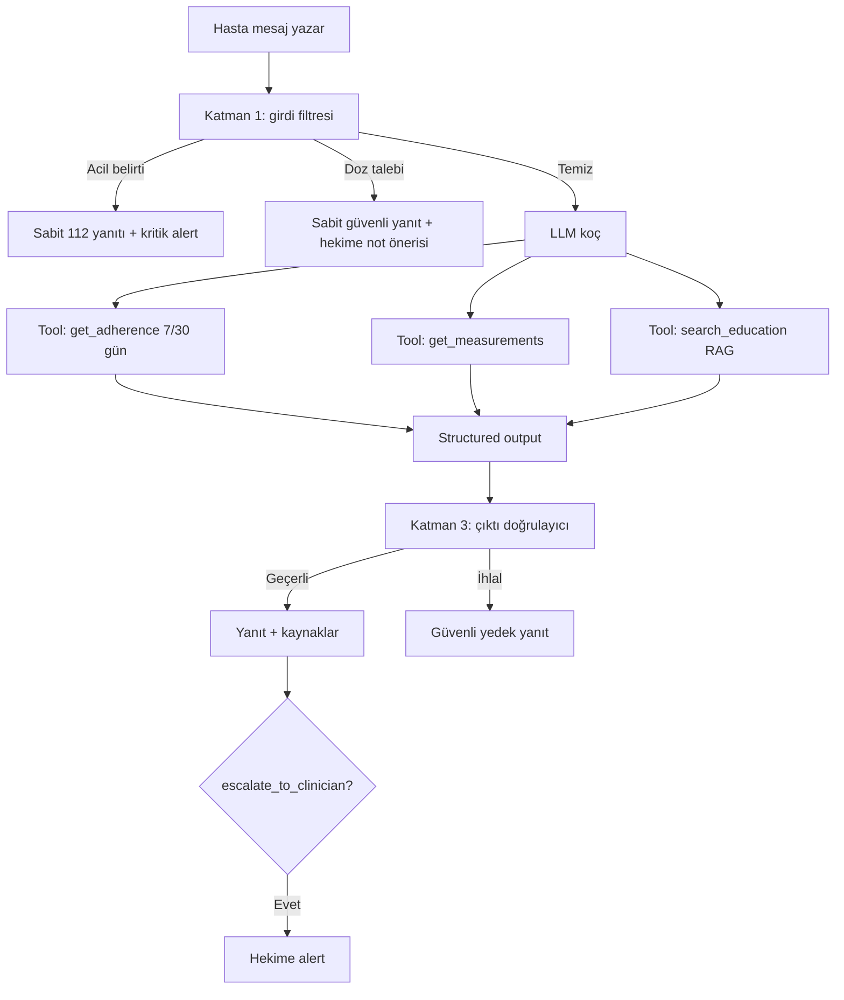
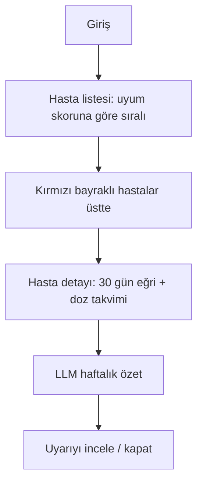

# Kullanıcı Akışları

## A. Hasta — günlük akış

```mermaid
flowchart TD
    A[Web push: "Metformin zamanı"] --> B[Bugün ekranı]
    B --> C{Dozu aldı mı?}
    C -- Aldım --> D[dose_log: taken]
    C -- Almadım --> E[dose_log: skipped + isteğe bağlı neden]
    D --> F[Ölçüm gir: açlık kan şekeri]
    E --> F
    F --> G{Eşik dışı mı?}
    G -- Evet --> H[Kritik uyarı + hekime bayrak]
    G -- Hayır --> I[Grafik güncellenir]
    I --> J[Koç kartı: günün geri bildirimi]
```

## B. Hasta — koç sohbeti



## C. Hekim — haftalık inceleme



## D. Bakım veren

Hasta, ayarlardan e-posta ile bakım veren ekler → bakım veren hesabıyla giriş yapar → bağlı hastanın bugün ekranını, grafiklerini ve uyarılarını **salt okunur** görür.
