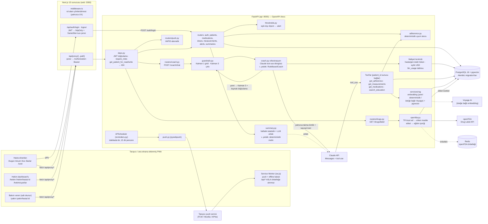
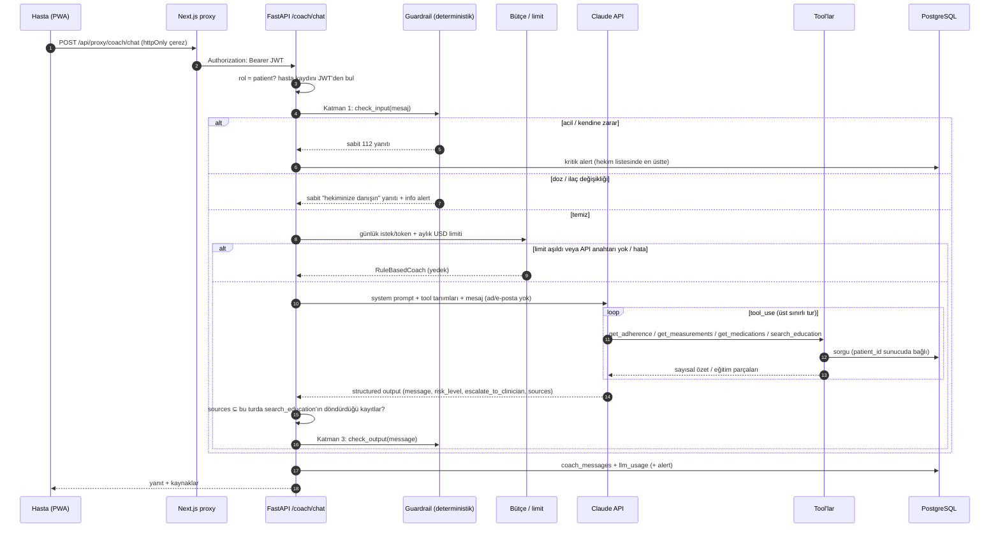

# Mimari

> İlk sürüm M1'de taslak olarak yazıldı; bu sürüm M5 itibarıyla **gerçekleşen sistemi** yansıtır.
> Tasarım kararları (aşağıda) M1'den bu yana değişmedi; yalnızca bileşenler somutlaştı.

## 1. Bileşen diyagramı



> Not: Diyagramdaki LLM, RAG, maliyet kontrolü ve LLM anlatısı M4 kapsamındadır.
> Maliyet sayaçları Redis'te değil, yalnızca PostgreSQL'deki `llm_usage` tablosunda tutulur (migration `0004_llm_usage`); Redis yalnızca openFDA etiket önbelleği (24 saat) içindir ve `REDIS_URL` tanımlıysa kullanılır.

## 2. Koç isteğinin yaşam döngüsü



## 3. Dağıtım (Docker Compose)

| Servis | İmaj | Port | Not |
|---|---|---|---|
| `db` | `pgvector/pgvector:pg16` | 5432 | `pgdata` volume, healthcheck |
| `redis` | `redis:7-alpine` | 6379 | önbellek |
| `api` | `./backend` (python:3.12-slim, root olmayan kullanıcı) | 8000 | açılışta `alembic upgrade head`; APScheduler aynı süreçte |
| `web` | `./frontend` (Next.js `standalone`, root olmayan kullanıcı) | 3000 | `API_URL=http://api:8000` — backend adresi tarayıcıya açılmaz |

## 4. Monorepo yapısı

```
ilac-kocu/
├── backend/
│   ├── app/
│   │   ├── routers/      auth, patients, medications, doses, measurements,
│   │   │                 alerts, summaries, coach, drugs, push
│   │   ├── services/     adherence, guardrails, coach, thresholds, summary,
│   │   │                 openfda, push, reminders, rag/
│   │   ├── deps.py       kimlik doğrulama + rol bazlı erişim (404 politikası)
│   │   ├── models.py     SQLAlchemy modelleri
│   │   └── seed.py       sentetik demo verisi
│   ├── alembic/          sürümlü migration'lar
│   └── tests/            pytest + guardrail_scenarios.yaml (red-team seti)
├── frontend/
│   ├── src/app/          (hasta)/…, hekim/…, yakin/…, api/auth, api/proxy
│   ├── src/middleware.ts rol alanı yönlendirmesi
│   └── public/           manifest, sw.js, offline.html, ikonlar
├── docs/                 M1, M4, M5 belgeleri, ER diyagramı
├── docker-compose.yml
└── .github/workflows/ci.yml
```

## 5. Önemli tasarım kararları

1. **Uyum skoru deterministik.** LLM hesaplamaz; `get_adherence` tool'u ile okur. Test edilebilir ve tutarlı (`backend/app/services/adherence.py`, `tests/test_adherence.py`).
2. **Guardrail LLM'in dışında.** Girdi ve çıktı filtreleri saf Python fonksiyonları; red-team setiyle CI'da doğrulanır. Acil durum yolu LLM'e hiç uğramaz; API anahtarı olmasa da çalışır.
3. **Hasta kimliğini tool'a sunucu bağlar.** Tool şemalarında `patient_id` parametresi yoktur; model başka hastaya erişemez.
4. **Kaynaklar sunucuda doğrulanır (grounding).** Modelin döndürdüğü `sources`, aynı turda `search_education` tool'unun gerçekten döndürdüğü kayıtlarla eşleşmezse atılır; uydurma kaynak hastaya ulaşmaz.
5. **Her LLM yolunun deterministik yedeği var.** API anahtarı yok, bütçe doldu ya da API hatası → kural tabanlı koç; haftalık anlatı üretilemezse → istatistikten üretilen sabit şablon.
6. **Token tarayıcı JavaScript'ine verilmez.** JWT yalnızca Next.js sunucusundaki httpOnly çerezde durur; tarayıcı yalnızca aynı kökenli `/api/proxy/*` ile konuşur, CORS ve token sızıntısı yüzeyi kalkar.
7. **Service worker sağlık verisini saklamaz.** `/api/*` yanıtları ve kişiye özel HTML önbelleğe alınmaz; yalnızca kişisel veri içermeyen kabuk dosyaları saklanır.
8. **Tek süreç zamanlayıcı.** APScheduler API süreci içinde koşar; proje ölçeğinde yeterli, yatay ölçeklemede ayrı worker'a taşınmalıdır (bkz. final rapor, sınırlılıklar).

## 6. Gerçekleşen sistem

<table>
<tr>
<td align="center"><br><sub>Bugün (hasta, PWA)</sub></td>
<td align="center"><br><sub>Koç (hasta, PWA)</sub></td>
</tr>
</table>


*Hekim dashboard'u: triyaj listesi.*


*FastAPI OpenAPI arayüzü (`/docs`).*
