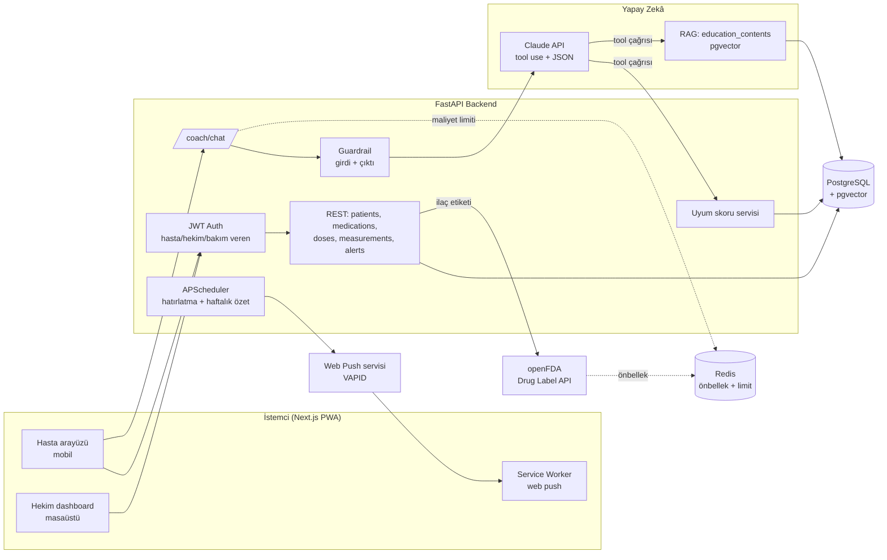

# Mimari



## Monorepo yapısı

```
ilac-kocu/
├── backend/            FastAPI, SQLAlchemy, Alembic, testler
│   ├── app/
│   │   ├── routers/    REST uç noktaları
│   │   └── services/   uyum skoru, guardrail, openFDA, koç
│   ├── alembic/        migration'lar
│   └── tests/          pytest + guardrail senaryo seti
├── frontend/           Next.js PWA (M3)
├── docs/               M1 belgeleri, ER diyagramı
├── docker-compose.yml
└── .github/workflows/  CI
```

## Önemli tasarım kararları

1. **Uyum skoru deterministik.** LLM hesaplamaz; `get_adherence` tool'u ile okur. Test edilebilir ve tutarlı.
2. **Guardrail LLM'in dışında.** Girdi ve çıktı filtreleri saf Python fonksiyonları; birim testleriyle doğrulanır.
3. **Hasta kimliği tool'a sunucu bağlar.** Model `patient_id` parametresi veremez; başka hastaya erişim yapısal olarak imkânsız.
4. **LLM sağlayıcı soyutlaması.** `CoachProvider` arayüzü; testlerde sahte sağlayıcı, prod'da Claude.
