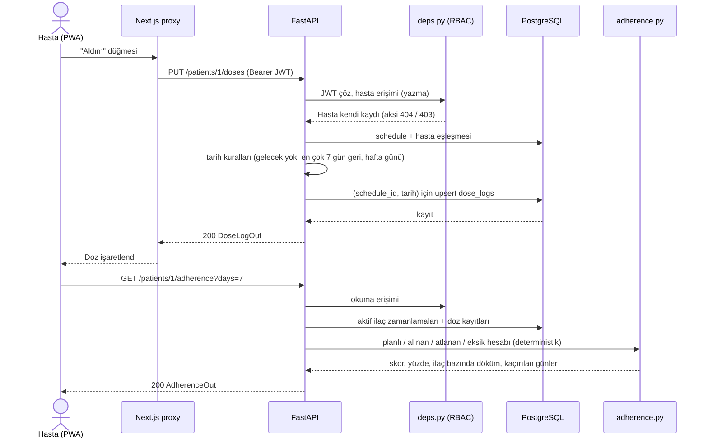
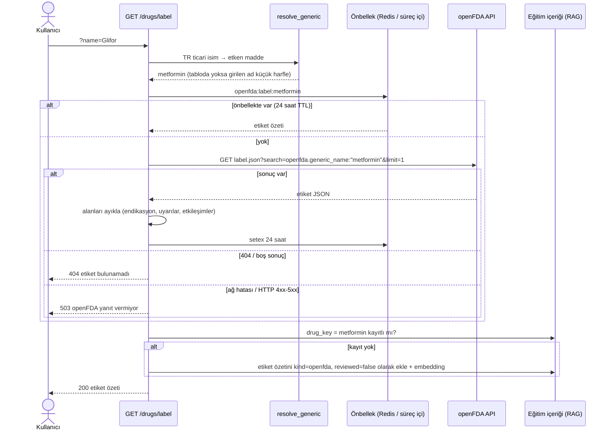

# API Referansı (M2)

FastAPI uygulaması (`backend/app/main.py`). Etkileşimli belge: **Swagger UI** `http://localhost:8000/docs`, ReDoc `/redoc`, ham şema `/openapi.json`. Bu belge Swagger'ın özetidir; tek doğruluk kaynağı koddur (`backend/app/routers/*.py`, `backend/app/schemas.py`).

Sütun "Kilometre taşı": uç noktanın hangi aşamada eklendiği. **M2** çekirdek CRUD'dur; diğerleri sonradan eklendi.

## 1. Kimlik doğrulama akışı

1. `POST /auth/register` ile hesap açılır (hasta için `consent: true` zorunlu).
2. `POST /auth/login`: **OAuth2 password form** (`application/x-www-form-urlencoded`, alanlar `username` = e-posta, `password`). JSON değil, form gönderilir; Swagger'ın **Authorize** düğmesi bunu otomatik yapar.
3. Yanıttaki `access_token` (JWT, HS256, `sub` = kullanıcı id, `role`, `iat`, `exp`; süre `JWT_EXPIRE_MINUTES`, varsayılan 60 dk) her istekte `Authorization: Bearer <token>` başlığıyla gönderilir.
4. Token geçersiz/süresi dolmuş/kullanıcı yoksa **401** (`WWW-Authenticate: Bearer`). Şifreler bcrypt ile saklanır (`backend/app/security.py`).

Roller: `patient` (kendi verisi, okuma + yazma), `clinician` (atanmış hastalar, okuma + uyarı kapatma), `caregiver` (bağlı hastalar, salt okuma).

## 2. Yetkilendirme (RBAC) kuralları

Uygulama: `backend/app/deps.py`.

| Durum | Yanıt | Gerekçe |
|---|---|---|
| Token yok / geçersiz | 401 | Kimlik doğrulanamadı |
| Hasta kaynağı yok **veya** kullanıcının o hastaya erişimi yok (başka hasta, atanmamış hekim, bağlı olmayan bakım veren) | **404** "Hasta bulunamadı" | Yetkisiz kişiye kaynağın var olup olmadığını sızdırmamak |
| Hastaya okuma erişimi var ama yazma deneniyor (hekim/bakım veren; ilaç, doz, ölçüm yazma) | **403** "Bu veriyi yalnızca hasta değiştirebilir" | Erişim var, rol yetersiz; varlık zaten bilinebilir |
| Role özel uç noktaya yanlış rol (ör. hekim `/coach/chat`) | **403** | `require_roles` |

Okuma erişimi: hasta için `patient.user_id == user.id`; hekim için `patient.clinician_id == hekim profili`; bakım veren için `patient_caregivers` bağı. Kural gerekçeleri: [../M1/03-veri-gizliligi.md](../M1/03-veri-gizliligi.md).

## 3. Doğrulama kuralları

| Alan | Kural | Hata |
|---|---|---|
| `RegisterIn.password` | 8..128 karakter | 422 |
| `RegisterIn.email` | geçerli e-posta, tekrar kayıt yasak | 422 / 409 |
| `RegisterIn.consent` | hasta rolünde `true` zorunlu | 422 |
| `birth_year` | 1900..2026 | 422 |
| `ScheduleIn.days_of_week` | `^[1-7]{1,7}$` (1=Pzt..7=Paz), tekrarlar ayıklanıp sıralanır | 422 |
| `MedicationIn.name` | 1..120 karakter; `dose_text` en çok 120 | 422 |
| `MeasurementIn.value` | 0 < değer < 1000 | 422 |
| `MeasurementIn.value2` | 0 < değer < 300 | 422 |
| Tansiyon (`blood_pressure`) | `value2` (diyastolik) **zorunlu** | 422 |
| Kan şekeri tipleri | `value2` **verilemez** | 422 |
| `measurements?days=` | 1..365 | 422 |
| `doses?days=` | 1..90 | 422 |
| `adherence?days=` | 1..90 | 422 |
| Doz işaretleme tarihi | gelecek olamaz ("Gelecek tarihli doz işaretlenemez") | 422 |
| Doz işaretleme tarihi | en fazla 7 gün geriye ("7 günden eski dozlar değiştirilemez") | 422 |
| Doz işaretleme tarihi | planın `days_of_week` listesindeki bir gün olmalı ("Bu gün için planlı doz yok") | 422 |
| Doz planı | `schedule_id` bu hastaya ait olmalı | 404 |
| `coach/chat message` | 1..2000 karakter | 422 |
| `drugs/label?name=` | 2..80 karakter | 422 |

"Bugün" sunucunun yapılandırılmış saat dilimine göre hesaplanır (`TIMEZONE`, varsayılan `Europe/Istanbul`).

Ölçüm eşikleri (`backend/app/services/thresholds.py`; klinisyence gözden geçirilmelidir). Eşik dışı ölçüm kaydı 201 ile kaydedilir ve yanıtta `alert` döner, ayrıca `alerts` tablosuna `kind = out_of_range` olarak yazılır:

| Tür | Koşul | Önem |
|---|---|---|
| Kan şekeri (her ikisi) | < 54 | critical |
| Kan şekeri (her ikisi) | 54..69 | warning |
| Kan şekeri (her ikisi) | > 300 | critical |
| Açlık kan şekeri | 181..300 | warning |
| Tansiyon | sistolik >= 180 veya diyastolik >= 120 | critical |
| Tansiyon | sistolik < 90 veya diyastolik < 60 | warning |
| Tansiyon | sistolik >= 160 veya diyastolik >= 100 | warning |

## 4. Uç nokta tablosu

Rol sütunu: P = hasta, H = hekim, B = bakım veren, "Giriş" = giriş yapmış herhangi bir rol (ayrıca hasta erişim kuralı §2). Her korumalı uç nokta ek olarak 401 döndürebilir; tabloda yalnızca uç noktaya özgü kodlar listelenmiştir.

### auth

| Metot | Yol | Rol | Açıklama | Hata kodları | Kilometre taşı |
|---|---|---|---|---|---|
| POST | `/auth/register` | herkese açık | Hesap oluşturur (hasta/hekim/bakım veren); 201 | 409 e-posta kayıtlı, 422 doğrulama/onay yok | M2 |
| POST | `/auth/login` | herkese açık | OAuth2 password form, JWT döner | 401 e-posta/şifre hatalı | M2 |
| GET | `/auth/me` | Giriş | Oturumdaki kullanıcı (`patient_id` / `clinician_id` ile) | 401 | M2 |

### patients

| Metot | Yol | Rol | Açıklama | Hata kodları | Kilometre taşı |
|---|---|---|---|---|---|
| GET | `/patients` | Giriş | H: atanmış hastalar (kritik uyarılı ve düşük uyumlular önce); B: bağlı hastalar; P: kendisi. 7/30 gün uyum, açık uyarı sayısı, son ölçüm | 404 (hasta profili yok) | M2 |
| GET | `/patients/me` | P | Kendi profili | 403, 404 | M2 |
| GET | `/patients/{patient_id}` | Giriş | Hasta profili | 404 | M2 |
| PATCH | `/patients/{patient_id}` | P (kendisi) | Doğum yılı, diyabet/hipertansiyon bayrakları | 403, 404, 422 | M2 |
| GET | `/patients/{patient_id}/adherence?days=7` | Giriş | Uyum skoru (1..90 gün) | 404, 422 | M2 |
| PUT | `/patients/me/clinician` | P | Takip edecek hekimi e-posta ile seçer | 404 hekim bulunamadı, 403 | M2 |
| POST | `/patients/me/caregivers` | P | Bakım veren bağlar (e-posta); 204, tekrar eklemek zararsız | 404 hesap bulunamadı, 403 | M2 |
| DELETE | `/patients/me/caregivers/{caregiver_user_id}` | P | Bakım veren bağını kaldırır; 204 | 403 | M2 |
| GET | `/patients/{patient_id}/summary` | Giriş | Haftalık özet (eski yol, geriye uyumluluk için; yeni istemciler `/summaries/{id}`) | 404 | M3 |

### medications

| Metot | Yol | Rol | Açıklama | Hata kodları | Kilometre taşı |
|---|---|---|---|---|---|
| GET | `/patients/{patient_id}/medications?include_inactive=false` | Giriş | İlaç listesi (varsayılan yalnızca aktif) | 404 | M2 |
| POST | `/patients/{patient_id}/medications` | P (kendisi) | İlaç + zamanlamalar oluşturur; 201 | 403, 404, 422 | M2 |
| GET | `/patients/{patient_id}/medications/{med_id}` | Giriş | Tek ilaç | 404 | M2 |
| PATCH | `/patients/{patient_id}/medications/{med_id}` | P (kendisi) | Alan güncelleme; `schedules` gönderilirse eşleşenler korunur, farklılar eklenir/çıkarılır | 403, 404, 422 | M2 |
| DELETE | `/patients/{patient_id}/medications/{med_id}` | P (kendisi) | **Pasife alır** (satır silinmez); 204 | 403, 404 | M2 |

### doses

| Metot | Yol | Rol | Açıklama | Hata kodları | Kilometre taşı |
|---|---|---|---|---|---|
| GET | `/patients/{patient_id}/doses/today?day=YYYY-MM-DD` | Giriş | Günün planlı dozları ve durumları (`status`: taken/skipped/null) | 404 | M2 |
| PUT | `/patients/{patient_id}/doses` | P (kendisi) | "Aldım/almadım" işaretler; aynı (schedule, gün) için günceller (idempotent) | 403, 404 hasta/doz planı yok, 422 gelecek / 7 günden eski / planda olmayan gün | M2 |
| GET | `/patients/{patient_id}/doses?days=30` | Giriş | Doz kayıtları geçmişi (1..90 gün) | 404, 422 | M2 |

### measurements

| Metot | Yol | Rol | Açıklama | Hata kodları | Kilometre taşı |
|---|---|---|---|---|---|
| POST | `/patients/{patient_id}/measurements` | P (kendisi) | Ölçüm ekler; eşik dışıysa yanıtta `alert` döner; 201 | 403, 404, 422 | M2 |
| GET | `/patients/{patient_id}/measurements?type=&days=30` | Giriş | Ölçüm listesi (eskiden yeniye) | 404, 422 | M2 |
| DELETE | `/patients/{patient_id}/measurements/{measurement_id}` | P (kendisi) | Ölçümü siler; 204 | 403, 404 | M2 |

### alerts

| Metot | Yol | Rol | Açıklama | Hata kodları | Kilometre taşı |
|---|---|---|---|---|---|
| GET | `/patients/{patient_id}/alerts?open_only=false` | Giriş | Hastanın uyarıları (yeniden eskiye) | 404 | M2 |
| GET | `/alerts` | H | Tüm hastalardaki açık uyarılar, kritik olanlar önce | 403 | M2 |
| POST | `/alerts/{alert_id}/ack` | H | Uyarıyı kapatır (`acknowledged_at` dolar) | 403, 404 uyarı yok / hasta size ait değil | M2 |

### drugs (openFDA)

| Metot | Yol | Rol | Açıklama | Hata kodları | Kilometre taşı |
|---|---|---|---|---|---|
| GET | `/drugs/search?q=&limit=` | Giriş | İlaç kataloğunda arama (TR ticari ad / etken madde, Türkçe karakter duyarsız); ilaç formundaki otomatik tamamlama | 422 sorgu 2..80 karakter değil | M5 |
| GET | `/drugs/label?name=` | Giriş | İlaç adından (TR ticari isim veya etken madde) openFDA etiket özeti; sonucu eğitim içeriğine de ekler (bakım veren istekleri hariç) | 404 etiket yok, 503 openFDA yanıt vermiyor, 422 ad uzunluğu | M2 |

Ayrıntı: [openfda-entegrasyonu.md](openfda-entegrasyonu.md).

### education (RAG)

| Metot | Yol | Rol | Açıklama | Hata kodları | Kilometre taşı |
|---|---|---|---|---|---|
| GET | `/education?kind=&tag=` | Giriş | Eğitim içerikleri (`kind`: curated/openfda) | 422 | M4 |
| GET | `/education/search?q=&k=3&tags=` | Giriş | Anlamsal + anahtar kelime hibrit arama; ilgisiz sorguda boş liste | 422 | M4 |
| POST | `/education/ingest-drug?name=` | Giriş | openFDA etiketini eğitim içeriğine ekler (aynı etken madde için idempotent); 201 | 404, 422 içerik çıkarılamadı, 503 | M4 |

### coach

| Metot | Yol | Rol | Açıklama | Hata kodları | Kilometre taşı |
|---|---|---|---|---|---|
| POST | `/coach/chat` | P | Guardrail'li koç sohbeti (`message`, `risk_level`, `escalate_to_clinician`, `sources`) | 403, 404, 422 | M4 |
| GET | `/coach/history?limit=50` | P | Sohbet geçmişi (1..200) | 403, 404, 422 | M4 |

### summaries

| Metot | Yol | Rol | Açıklama | Hata kodları | Kilometre taşı |
|---|---|---|---|---|---|
| GET | `/summaries/{patient_id}` | Giriş | Haftalık özet: uyum, kaçırılan dozlar, ölçüm istatistikleri, uyarı sayısı, `narrative` (LLM veya şablon) | 404 | M4 |

### push

| Metot | Yol | Rol | Açıklama | Hata kodları | Kilometre taşı |
|---|---|---|---|---|---|
| GET | `/push/vapid-public-key` | P | Tarayıcı aboneliği için VAPID açık anahtarı | 403, 503 yapılandırılmamış | M3 |
| POST | `/push/subscribe` | P | Abonelik kaydeder (aynı endpoint ise günceller); 204 | 403, 422 | M3 |
| DELETE | `/push/subscribe` | P | Aboneliği kaldırır; 204 | 403, 422 | M3 |
| POST | `/push/test` | P | Deneme bildirimi yollar (`sent` sayısı) | 403, 503 | M3 |

### system

| Metot | Yol | Rol | Açıklama | Kilometre taşı |
|---|---|---|---|---|
| GET | `/health` | herkese açık | `{"status":"ok"}` | M2 |

## 5. Örnek istek ve yanıtlar

Örneklerdeki id ve zaman değerleri örnektir. `$TOKEN` giriş yanıtındaki `access_token`'dır.

### 5.1 Giriş

```bash
curl -X POST http://localhost:8000/auth/login \
  -H "Content-Type: application/x-www-form-urlencoded" \
  -d "username=hasta@demo.local&password=demo12345"
```

```json
{
  "access_token": "eyJhbGciOiJIUzI1NiIsInR5cCI6IkpXVCJ9...",
  "token_type": "bearer",
  "role": "patient"
}
```

Hatalı şifre: `401 {"detail": "E-posta veya şifre hatalı"}`.

### 5.2 Zamanlamalarıyla ilaç oluşturma

```bash
curl -X POST http://localhost:8000/patients/1/medications \
  -H "Authorization: Bearer $TOKEN" -H "Content-Type: application/json" \
  -d '{
    "name": "Glifor",
    "active_ingredient": "metformin",
    "dose_text": "1000 mg",
    "notes": "Yemekle birlikte",
    "schedules": [
      {"time_of_day": "08:00", "days_of_week": "1234567"},
      {"time_of_day": "20:00", "days_of_week": "1234567"}
    ]
  }'
```

`201 Created`:

```json
{
  "id": 7,
  "patient_id": 1,
  "name": "Glifor",
  "active_ingredient": "metformin",
  "dose_text": "1000 mg",
  "notes": "Yemekle birlikte",
  "active": true,
  "schedules": [
    {"id": 21, "time_of_day": "08:00:00", "days_of_week": "1234567", "start_date": "2026-10-04"},
    {"id": 22, "time_of_day": "20:00:00", "days_of_week": "1234567", "start_date": "2026-10-04"}
  ]
}
```

### 5.3 Doz işaretleme (PUT, idempotent)

```bash
curl -X PUT http://localhost:8000/patients/1/doses \
  -H "Authorization: Bearer $TOKEN" -H "Content-Type: application/json" \
  -d '{"schedule_id": 21, "scheduled_date": "2026-10-04", "status": "taken"}'
```

```json
{
  "id": 105,
  "schedule_id": 21,
  "scheduled_date": "2026-10-04",
  "status": "taken",
  "reason": null,
  "logged_at": "2026-10-04T05:12:44.318201Z"
}
```

Aynı istek tekrarlanırsa aynı `id` döner (yeni satır eklenmez). `"status": "skipped"` ve `"reason": "Midem bulandı"` ile güncellenebilir. Hata örnekleri:

```json
{"detail": "Gelecek tarihli doz işaretlenemez"}
{"detail": "7 günden eski dozlar değiştirilemez"}
{"detail": "Bu gün için planlı doz yok"}
```

(hepsi 422).

### 5.4 Eşik dışı ölçüm: uyarı döner

```bash
curl -X POST http://localhost:8000/patients/1/measurements \
  -H "Authorization: Bearer $TOKEN" -H "Content-Type: application/json" \
  -d '{"type": "blood_pressure", "value": 190, "value2": 115, "note": "Sabah"}'
```

`201 Created`:

```json
{
  "id": 52,
  "type": "blood_pressure",
  "value": 190.0,
  "value2": 115.0,
  "unit": "mmHg",
  "note": "Sabah",
  "measured_at": "2026-10-04T05:20:10.912004Z",
  "alert": {
    "id": 9,
    "patient_id": 1,
    "severity": "critical",
    "kind": "out_of_range",
    "message": "Çok yüksek tansiyon: 190/115 mmHg",
    "created_at": "2026-10-04T05:20:10.915332Z",
    "acknowledged_at": null
  }
}
```

Normal ölçümde `"alert": null`. `value2` olmadan tansiyon gönderilirse 422: "Tansiyon ölçümü için diyastolik değer (value2) gereklidir".

### 5.5 Uyum skoru

```bash
curl http://localhost:8000/patients/1/adherence?days=7 -H "Authorization: Bearer $TOKEN"
```

```json
{
  "start": "2026-09-28",
  "end": "2026-10-04",
  "planned": 14,
  "taken": 10,
  "skipped": 1,
  "missing": 3,
  "score": 0.714,
  "percent": 71,
  "band": "orta",
  "by_medication": {
    "7": {"planned": 14, "taken": 10, "score": 0.714}
  },
  "missed_dates": ["2026-09-30", "2026-10-02"]
}
```

`by_medication` anahtarı ilaç id'sidir; ilaç bazında yalnızca `planned`, `taken`, `score` bulunur; bant eşikleri ve kurallar için bkz. [../M4/uyum-skoru-dogrulama.md](../M4/uyum-skoru-dogrulama.md). Planlı doz yoksa `score` ve `percent` `null`, `band` `veri_yok` olur.

### 5.6 openFDA ilaç etiketi

```bash
curl "http://localhost:8000/drugs/label?name=Glifor" -H "Authorization: Bearer $TOKEN"
```

```json
{
  "query": "Glifor",
  "resolved_generic": "metformin",
  "brand_names": ["METFORMIN HYDROCHLORIDE"],
  "generic_names": ["METFORMIN HYDROCHLORIDE"],
  "active_ingredients": ["METFORMIN HYDROCHLORIDE"],
  "indications": "Metformin hydrochloride tablets are indicated as an adjunct to diet and exercise to improve glycemic control in adults and pediatric patients 10 years of age and older with type 2 diabetes mellitus.",
  "warnings": "Lactic acidosis: Postmarketing cases of metformin-associated lactic acidosis have resulted in death, hypothermia, hypotension, and resistant bradyarrhythmias...",
  "drug_interactions": "Carbonic anhydrase inhibitors may increase the risk of lactic acidosis...",
  "source_name": "openFDA Drug Label API (ABD FDA etiketi)",
  "source_url": "https://api.fda.gov/drug/label.json?search=openfda.generic_name:\"metformin\"",
  "set_id": "00000000-0000-0000-0000-000000000000",
  "disclaimer": "Bu bilgi ABD ilaç etiketinden alınmıştır, eğitim amaçlıdır; tedavi kararı için hekiminize danışın."
}
```

Metinler örnek olarak kısaltılmıştır (alan başına en çok 1200 karakter). Hatalar: bilinmeyen ilaç `404 {"detail": "'xyz' için openFDA'da etiket bulunamadı"}`, servis erişilemez `503 {"detail": "openFDA şu an yanıt vermiyor"}`.

## 6. Sıra diyagramları

### 6.1 Hasta doz işaretler, uyum skoru güncellenir



### 6.2 openFDA etiket sorgusu



Eğitim içeriğine ekleme en iyi çabadır; başarısız olursa istek yine 200 döner (hata günlüğe yazılır).
