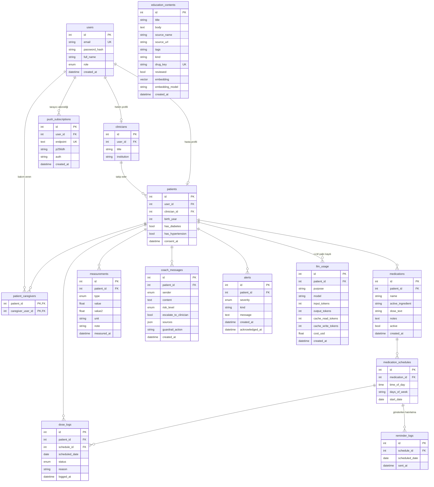

# Veritabanı Şeması ve Migration (M2)

Kaynak: `backend/app/models.py` (SQLAlchemy 2.0), migration'lar: `backend/alembic/versions/`. Üretim veritabanı **PostgreSQL 16 + pgvector**; testlerde SQLite kullanılır.

## 1. ER diyagramı



Bağımsız sürüm: [../er-diyagrami.md](../er-diyagrami.md). `education_contents` hiçbir tabloya FK ile bağlı değildir (ortak içerik korpusu).

## 2. Tablo tablo açıklama

Gösterim: SQLAlchemy tipi. "NN" = NOT NULL. Tüm tablolarda `id` otomatik artan tamsayı birincil anahtardır (aksi belirtilmedikçe).

### 2.1 `users`

Giriş yapan tüm hesaplar (hasta, hekim, bakım veren).

| Kolon | Tip | Kısıt | Açıklama |
|---|---|---|---|
| id | Integer | PK | |
| email | String(255) | NN, UNIQUE, indeksli (`ix_users_email`) | Küçük harfe çevrilerek saklanır |
| password_hash | String(255) | NN | bcrypt özeti; düz şifre saklanmaz |
| full_name | String(120) | NN | |
| role | Enum `user_role` | NN | `patient`, `clinician`, `caregiver` |
| created_at | DateTime(timezone=True) | NN, varsayılan `utcnow` | |

### 2.2 `clinicians`

| Kolon | Tip | Kısıt | Açıklama |
|---|---|---|---|
| id | Integer | PK | |
| user_id | Integer | NN, UNIQUE, FK `users.id` ON DELETE CASCADE | Bir kullanıcı en fazla bir hekim profili |
| title | String(80) | NULL | Ör. "Dr." |
| institution | String(160) | NULL | |

### 2.3 `patients`

| Kolon | Tip | Kısıt | Açıklama |
|---|---|---|---|
| id | Integer | PK | |
| user_id | Integer | NN, UNIQUE, FK `users.id` ON DELETE CASCADE | |
| clinician_id | Integer | NULL, FK `clinicians.id` ON DELETE SET NULL, indeksli (`ix_patients_clinician_id`) | Hekim silinirse hasta kalır, bağ kopar |
| birth_year | Integer | NULL | Yalnızca doğum yılı (veri minimizasyonu) |
| has_diabetes | Boolean | NN, varsayılan false | |
| has_hypertension | Boolean | NN, varsayılan false | |
| consent_at | DateTime(timezone=True) | NULL | Veri işleme onayının zamanı (bkz. 4.5) |

### 2.4 `patient_caregivers`

Hasta ile bakım veren arasındaki çoktan çoğa bağ (salt okunur erişim).

| Kolon | Tip | Kısıt |
|---|---|---|
| patient_id | Integer | PK (bileşik), FK `patients.id` ON DELETE CASCADE |
| caregiver_user_id | Integer | PK (bileşik), FK `users.id` ON DELETE CASCADE |

### 2.5 `medications`

| Kolon | Tip | Kısıt | Açıklama |
|---|---|---|---|
| id | Integer | PK | |
| patient_id | Integer | NN, FK `patients.id` ON DELETE CASCADE, indeksli | |
| name | String(120) | NN | Ticari ad, ör. "Glifor" |
| active_ingredient | String(120) | NULL | Etken madde |
| dose_text | String(120) | NULL | Hekimin yazdığı hâliyle ("1000 mg"); sayısal doz hesabı yapılmaz |
| notes | Text | NULL | |
| active | Boolean | NN, varsayılan true | Silme yerine pasife alma (bkz. 4.1) |
| created_at | DateTime(timezone=True) | NN | |

### 2.6 `medication_schedules`

Bir ilacın tekrarlayan doz zamanı.

| Kolon | Tip | Kısıt | Açıklama |
|---|---|---|---|
| id | Integer | PK | |
| medication_id | Integer | NN, FK `medications.id` ON DELETE CASCADE, indeksli | |
| time_of_day | Time | NN | Yerel duvar saati (saat dilimi yok) |
| days_of_week | String(7) | NN, varsayılan `"1234567"` | ISO hafta günleri: 1=Pzt .. 7=Paz; `"135"` = Pzt/Çar/Cum. API'de `^[1-7]{1,7}$`, tekrarsız ve sıralı |
| start_date | Date | NN, varsayılan bugün (UTC) | Bu tarihten önceki günler planlı sayılmaz |

### 2.7 `dose_logs`

"Aldım / almadım" kayıtları.

| Kolon | Tip | Kısıt | Açıklama |
|---|---|---|---|
| id | Integer | PK | |
| patient_id | Integer | NN, FK `patients.id` ON DELETE CASCADE, indeksli | |
| schedule_id | Integer | NN, FK `medication_schedules.id` ON DELETE CASCADE | |
| scheduled_date | Date | NN, indeksli (`ix_dose_logs_scheduled_date`) | Dozun planlandığı gün |
| status | Enum `dose_status` | NN | `taken`, `skipped` |
| reason | String(255) | NULL | Atlama nedeni |
| logged_at | DateTime(timezone=True) | NN | Son güncelleme zamanı |

Benzersizlik: **`uq_dose_per_schedule_day` UNIQUE (schedule_id, scheduled_date)**.

### 2.8 `measurements`

| Kolon | Tip | Kısıt | Açıklama |
|---|---|---|---|
| id | Integer | PK | |
| patient_id | Integer | NN, FK `patients.id` ON DELETE CASCADE, indeksli | |
| type | Enum `measurement_type` | NN | `glucose_fasting`, `glucose_postprandial`, `blood_pressure` |
| value | Float | NN | Kan şekeri mg/dL veya sistolik mmHg |
| value2 | Float | NULL | Diyastolik mmHg (yalnızca tansiyon) |
| unit | String(16) | NN | Sunucu belirler: `mg/dL` veya `mmHg` |
| note | String(255) | NULL | |
| measured_at | DateTime(timezone=True) | NN, indeksli (`ix_measurements_measured_at`) | İstemci vermezse sunucu saati |

### 2.9 `alerts`

| Kolon | Tip | Kısıt | Açıklama |
|---|---|---|---|
| id | Integer | PK | |
| patient_id | Integer | NN, FK `patients.id` ON DELETE CASCADE, indeksli | |
| severity | Enum `alert_severity` | NN | `info`, `warning`, `critical` |
| kind | String(40) | NN | Ör. `out_of_range`, `emergency_symptom`, `low_adherence` |
| message | Text | NN | |
| created_at | DateTime(timezone=True) | NN | |
| acknowledged_at | DateTime(timezone=True) | NULL | NULL = açık uyarı; hekim kapatınca dolar |

### 2.10 `coach_messages`

| Kolon | Tip | Kısıt | Açıklama |
|---|---|---|---|
| id | Integer | PK | |
| patient_id | Integer | NN, FK `patients.id` ON DELETE CASCADE, indeksli | |
| sender | Enum `message_sender` | NN | `patient`, `coach` |
| content | Text | NN | |
| risk_level | Enum `risk_level` | NULL | `low`, `medium`, `high`, `emergency` |
| escalate_to_clinician | Boolean | NN, varsayılan false | |
| sources | JSON | NULL | Koçun gösterdiği kaynaklar |
| guardrail_action | String(40) | NULL | Ör. `llm_fallback`, `budget_exceeded` |
| created_at | DateTime(timezone=True) | NN | |

### 2.11 `push_subscriptions` (M2 sonrası, migration 0002)

| Kolon | Tip | Kısıt |
|---|---|---|
| id | Integer | PK |
| user_id | Integer | NN, FK `users.id` ON DELETE CASCADE, indeksli (`ix_push_subscriptions_user_id`) |
| endpoint | Text | NN, UNIQUE |
| p256dh | String(255) | NN |
| auth | String(255) | NN |
| created_at | DateTime(timezone=True) | NN |

### 2.12 `reminder_logs` (M2 sonrası, migration 0002)

Gönderilmiş doz hatırlatmaları; aynı doz için aynı gün ikinci bildirimi engeller.

| Kolon | Tip | Kısıt |
|---|---|---|
| id | Integer | PK |
| schedule_id | Integer | NN, FK `medication_schedules.id` ON DELETE CASCADE |
| scheduled_date | Date | NN |
| sent_at | DateTime(timezone=True) | NN |

Benzersizlik: `uq_reminder_per_schedule_day` UNIQUE (schedule_id, scheduled_date).

### 2.13 `education_contents`

Koçun kaynak gösterdiği eğitim içeriği korpusu. `title`..`created_at` 0001'de, `kind` ve sonrası 0003_rag ile geldi.

| Kolon | Tip | Kısıt | Açıklama |
|---|---|---|---|
| id | Integer | PK | |
| title | String(200) | NN | |
| body | Text | NN | |
| source_name | String(160) | NN | |
| source_url | String(500) | NULL | |
| tags | String(200) | NULL | Virgülle ayrılmış |
| created_at | DateTime(timezone=True) | NN | |
| kind | String(20) | NN, varsayılan `curated` | `curated` veya `openfda` (0003) |
| drug_key | String(80) | NULL, UNIQUE indeks (`ix_education_contents_drug_key`) | openFDA kaydında etken madde; aynı etken madde tek kayıt (0003) |
| reviewed | Boolean | NN, varsayılan false | Klinisyen gözden geçirmesi (0003) |
| embedding | `vector(384)` (SQLite'ta JSON), `deferred` | NULL | PostgreSQL'de HNSW cosine indeksi `ix_education_contents_embedding_hnsw` (0003) |
| embedding_model | String(80) | NULL | (0003) |

### 2.14 `llm_usage` (M2 sonrası, migration 0004_llm_usage)

LLM çağrı başına token ve maliyet kaydı. Mesaj içeriği tutulmaz.

| Kolon | Tip | Kısıt | Açıklama |
|---|---|---|---|
| id | Integer | PK | |
| patient_id | Integer | NULL, FK `patients.id` ON DELETE SET NULL, indeksli | Hasta silinince kayıt anonim toplam olarak kalır |
| purpose | String(20) | NN | `coach` veya `summary` |
| model | String(80) | NN | |
| input_tokens, output_tokens, cache_read_tokens, cache_write_tokens | Integer | NN, varsayılan 0 | |
| cost_usd | Float | NN, varsayılan 0.0 | |
| created_at | DateTime(timezone=True) | NN, indeksli (`ix_llm_usage_created_at`) | |

### 2.15 Enum tipleri

| PostgreSQL enum | Değerler |
|---|---|
| `user_role` | patient, clinician, caregiver |
| `dose_status` | taken, skipped |
| `measurement_type` | glucose_fasting, glucose_postprandial, blood_pressure |
| `alert_severity` | info, warning, critical |
| `message_sender` | patient, coach |
| `risk_level` | low, medium, high, emergency |

## 3. Migration zinciri

Araç: Alembic (`backend/alembic.ini`, `backend/alembic/`). Zincir doğrusaldır (tek baş).

| Sıra | Revizyon | Dosya | Ekledikleri | Kilometre taşı |
|---|---|---|---|---|
| 1 | `0001` | `0001_initial_schema.py` | `users`, `clinicians`, `patients`, `patient_caregivers`, `medications`, `medication_schedules`, `dose_logs`, `measurements`, `coach_messages`, `alerts`, `education_contents`; enum tipleri ve indeksler | **M2** |
| 2 | `0002` | `0002_push_reminders.py` | `push_subscriptions`, `reminder_logs` (+ `uq_reminder_per_schedule_day`) | M3 (web push + hatırlatma) |
| 3 | `0003_rag` | `0003_rag.py` | `education_contents`'a `kind`, `drug_key` (UNIQUE), `reviewed`, `embedding`, `embedding_model`; PostgreSQL'de `CREATE EXTENSION vector` ve HNSW cosine indeksi | M4 (RAG) |
| 4 | `0004_llm_usage` | `0004_llm_usage.py` | `llm_usage` tablosu ve iki indeks | M4 (maliyet kontrolü) |

Notlar:

- `0003_rag` dialect'e duyarlıdır: PostgreSQL'de `vector(384)` + HNSW; SQLite'ta embedding JSON olur, vektör indeksi yoktur. `downgrade` `vector` eklentisini kaldırmaz (başka nesneler kullanıyor olabilir).
- Konteyner başlangıcında `alembic upgrade head` otomatik çalışır (`backend/Dockerfile`).
- Yeni migration: `alembic revision --autogenerate -m "..."`; üretilen dosya elle gözden geçirilir.

## 4. Tasarım kararları

### 4.1 İlaç silinmez, pasife alınır
`DELETE /patients/{id}/medications/{med_id}` satırı silmez, `active = false` yapar. Sebep: geçmiş doz kayıtları ve uyum skoru ilaca bağlıdır; silmek geçmiş uyumu bozar ve hekimin izleme verisini yok eder. Listeler varsayılan olarak yalnızca aktifleri döner (`include_inactive=true` ile hepsi). Uyum hesabı yalnızca aktif ilaçların zamanlamalarını planlı sayar. İlaç güncellemesinde (`PATCH`) eşleşen zamanlamalar korunur, çünkü doz kayıtları onların `id`'sine bağlıdır.

### 4.2 `dose_logs` benzersizliği ve idempotent PUT
`UNIQUE (schedule_id, scheduled_date)` bir doz yuvası için en fazla bir kayıt garanti eder. `PUT /patients/{id}/doses` aynı yuvaya tekrar çağrılırsa yeni satır eklemez, mevcut kaydı günceller (hasta fikrini değiştirebilir, ağ tekrarı çift kayıt üretmez, uyum paydası şişmez).

### 4.3 Enum'lar
Durum ve tür alanları PostgreSQL enum tipidir (`values_callable` ile Python enum'un **değerleri** saklanır, adları değil). Geçersiz değer veritabanı düzeyinde de reddedilir. `alerts.kind` ve `coach_messages.guardrail_action` serbest metindir; sık değişebilen etiketler olduğu için enum yapılmadı.

### 4.4 Saat dilimi bilinçli zaman damgaları
Tüm olay zamanları `DateTime(timezone=True)` olup UTC üretilir (`utcnow()`). Buna karşılık `scheduled_date` (Date) ve `time_of_day` (Time) hastanın **yerel takvim günü / duvar saatidir**: "bugün" hesabı `settings.timezone` ile yapılır (`doses.local_today`). Böylece gece yarısına yakın bir doz yanlış güne düşmez.

### 4.5 `consent_at`
Hasta kaydı veri işleme onayı olmadan açılmaz (`RegisterIn`: `consent=true` zorunlu, aksi 422). Onay anı `patients.consent_at`'e UTC olarak yazılır; onayın ispatı içindir ([../M1/03-veri-gizliligi.md](../M1/03-veri-gizliligi.md)). Hekim paylaşımı da hastanın açık eylemidir (`PUT /patients/me/clinician`).

### 4.6 Silme davranışları (FK)
- Kullanıcı silinirse profili, ilaçları, dozları, ölçümleri, mesajları, uyarıları CASCADE ile silinir (veri silme hakkı).
- Hekim silinirse hastalar kalır (`SET NULL`).
- `llm_usage.patient_id` `SET NULL`: maliyet toplamları hasta silinse de korunur ama kişiye bağlanamaz.

### 4.7 Veri minimizasyonu
Yalnızca doğum yılı tutulur (tam doğum tarihi, TC kimlik, telefon, adres yok). Ölçüm değerleri sayısaldır; serbest metin `note` kısadır (255).

## 5. PostgreSQL + pgvector

- Görüntü: `pgvector/pgvector:pg16` (hem `docker-compose.yml` hem CI servis konteyneri). Veritabanı `ilac_kocu`, kullanıcı `ilac`.
- `0003_rag` `CREATE EXTENSION IF NOT EXISTS vector` çalıştırır; eklenti görüntüde hazır geldiği için ek kurulum gerekmez. Düz `postgres:16` görüntüsünde bu migration başarısız olur.
- `education_contents.embedding` kolonu `vector(384)`; HNSW indeksi `vector_cosine_ops` ile kosinüs benzerliği içindir.
- openFDA önbelleği için ayrı bir Redis (`redis:7-alpine`) çalışır; veritabanı şemasının parçası değildir ([openfda-entegrasyonu.md](openfda-entegrasyonu.md)).

## 6. CI'da migration doğrulaması

`.github/workflows/ci.yml` backend işi, PostgreSQL (pgvector) servis konteyneri üzerinde şunları sırayla çalıştırır:

```bash
alembic upgrade head
alembic downgrade base
alembic upgrade head
python -m app.seed
```

Bu tur, her migration'ın hem ileri hem geri yönde çalıştığını ve geri alındıktan sonra yeniden uygulanabildiğini gösterir; ardından demo veri yüklemesi şemanın kullanılabilir olduğunu doğrular. Birim testler SQLite'ta koştuğundan PostgreSQL'e özgü davranış bu adımla yakalanır.
