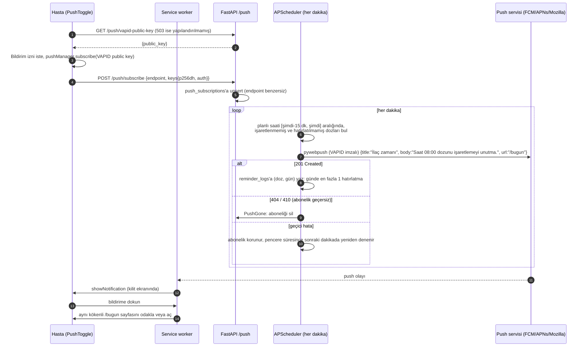

# Güvenlik ve PWA

Platform sağlık verisi işler ([M1 veri gizliliği](../M1/03-veri-gizliligi.md)). Bu belge arayüz katmanındaki güvenlik kararlarını, PWA davranışını ve web push akışını anlatır.

## 1. Kimlik doğrulama mimarisi

```mermaid
sequenceDiagram
    autonumber
    participant B as Tarayıcı
    participant N as Next.js (route handler)
    participant F as FastAPI

    Note over B,F: Giriş
    B->>N: POST /api/auth/login {email, password}
    N->>F: POST /auth/login (form: username, password)
    F-->>N: {access_token (JWT), role}
    N-->>B: 200 {role} + Set-Cookie ik_token (httpOnly), ik_role (httpOnly)
    Note right of B: JWT yanıt gövdesinde yok;<br/>JavaScript token'ı göremez

    Note over B,F: Sonraki istekler
    B->>N: GET /api/proxy/patients/1/doses/today (çerezler otomatik)
    N->>N: ik_token çerezini oku
    N->>F: GET /patients/1/doses/today + Authorization: Bearer JWT
    F->>F: JWT doğrula, rol ve hasta erişimini denetle
    F-->>N: 200 JSON (yetkisizse 404)
    N-->>B: aynı yanıt (cache: no-store)
    Note over B: 401 gelirse istemci /giris'e yönlendirir
```

Temel kararlar:

| Karar | Uygulama | Neden |
|---|---|---|
| **JWT hiç JavaScript'e açılmaz** | Token yalnızca `httpOnly` çerezde durur (`SameSite=Lax`, üretimde `Secure`, ömür 1 saat). Login yanıt gövdesinde yalnızca `role` döner; `localStorage`/`sessionStorage` kullanılmaz. | XSS açığı olsa bile saldırgan token'ı okuyup dışarı taşıyamaz. |
| **Tarayıcı backend'i görmez** | Tüm çağrılar `/api/proxy/<yol>` üzerinden gider (`src/lib/api.ts`); proxy (`app/api/proxy/[...path]/route.ts`) çerezdeki token'ı `Authorization: Bearer` başlığına ekler ve `API_URL`'ye iletir. | Backend adresi tarayıcıya açılmaz, CORS gerekmez, token sunucu tarafında eklenir. |
| **Rol çerezi yalnızca yönlendirme içindir** | `ik_role` çerezi middleware'in kullanıcıyı doğru ana sayfaya göndermesi için vardır. | Çerez istemcide değiştirilebilir; bu yüzden hiçbir veri erişimi buna dayanmaz. Rolü değiştiren kullanıcı yalnızca yanlış bir boş sayfa görür, API JWT'deki rolle yetkiyi yeniden denetler. |
| **Yetki kararı her zaman backend'de** | Her istekte JWT doğrulanır; hasta kendi verisine, hekim atandığı hastaya, bakım veren bağlı olduğu hastaya (salt okunur) erişir. Yetkisiz erişim 404 döner (kaynağın varlığı sızdırılmaz). | Arayüz kontrolleri kullanıcı deneyimidir, güvenlik sınırı değildir. |
| **Çıkış** | `POST /api/auth/logout` iki çerezi de siler. | |
| **Yanıtlar önbelleğe alınmaz** | Proxy `cache: "no-store"` ile çağırır. | Kişisel veri ara katmanda saklanmaz. |

## 2. Middleware rota koruması

`src/middleware.ts` her sayfa isteğinde çalışır (`/api`, `/_next`, statik dosyalar, `sw.js`, `offline.html`, ikonlar hariç):

| Durum | Davranış |
|---|---|
| Token çerezi yok, `/giris` dışında bir yol | `/giris`'e yönlendir |
| Token var, yol `/` veya `/giris` | Rolün ana sayfasına yönlendir (`patient → /bugun`, `clinician → /hekim`, `caregiver → /yakin`) |
| Hasta alanı (`/bugun`, `/olcum`, `/koc`, `/ilaclar`, `/ozet`) ve rol hasta değil | Rolün ana sayfasına yönlendir |
| `/hekim…` ve rol hekim değil, `/yakin…` ve rol bakım veren değil | Rolün ana sayfasına yönlendir |

Süresi dolmuş token'da sayfa açılır ama ilk API çağrısı 401 döner ve istemci `/giris`'e yönlendirir. Bu middleware yalnızca **kullanıcı deneyimi** içindir; savunma katmanı değildir (bkz. rol çerezi).

## 3. Güvenlik başlıkları

`frontend/next.config.ts` tüm yanıtlara şu başlıkları ekler:

| Başlık | Değer | Koruma |
|---|---|---|
| `X-Content-Type-Options` | `nosniff` | MIME türü tahminiyle betik çalıştırmayı engeller |
| `X-Frame-Options` | `DENY` | Clickjacking: uygulama iframe içine alınamaz |
| `Referrer-Policy` | `strict-origin-when-cross-origin` | Yol/sorgu bilgisi başka kökene sızmaz |
| `Permissions-Policy` | `camera=(), microphone=(), geolocation=(), payment=(), usb=(), interest-cohort=()` | Kullanılmayan tarayıcı yeteneklerini kapatır |

Ek olarak:

- `poweredByHeader: false` — `X-Powered-By: Next.js` bilgisi verilmez.
- `/sw.js` için `Cache-Control: no-cache, no-store, must-revalidate` ve `Service-Worker-Allowed: /`: service worker güncellemeleri gecikmez.
- `/manifest.webmanifest` doğru `application/manifest+json` türüyle sunulur.
- Docker imajı `output: "standalone"` derlemesini **root olmayan kullanıcıyla** (`nextjs`, uid 1001) çalıştırır; `API_URL` çalışma zamanında okunur (`frontend/Dockerfile`).

## 4. PWA

### 4.1 Manifest

`public/manifest.webmanifest`: ad "İlaç Koçu", `start_url: /bugun`, `display: standalone`, `orientation: portrait`, `lang: tr`, tema rengi `#0f766e`, kategoriler `health`/`medical`. İkonlar: 192 ve 512 (`any`), 192 ve 512 (`maskable`); ayrıca `apple-touch-icon` ve bildirim rozeti (`badge-72.png`). Hasta uygulamayı ana ekrana ekleyip tam ekran açabilir.

### 4.2 Service worker stratejisi (`public/sw.js`)

**Gizlilik kuralı: sağlık verisi içeren hiçbir yanıt önbelleğe alınmaz.** Paylaşılan veya kaybolan bir cihazda önbellekten ölçüm, doz veya koç sohbeti okunamamalıdır.

| İstek türü | Strateji |
|---|---|
| `/api/*` (proxy dahil: dozlar, ölçümler, koç, uyarılar) | SW hiç karışmaz; doğrudan ağa gider, Cache Storage'a **asla yazılmaz** |
| Sayfa geçişleri (HTML) | **Önce ağ**, önbelleğe yazılmaz (sayfa sunucuda kişiye özel render edilir). Ağ yoksa `offline.html` gösterilir |
| `/_next/static/*` (içerik-hash'li) | Önce önbellek (değişmez, kişisel veri içermez) |
| Kabuk dosyaları (`offline.html`, manifest, ikonlar) | Önce ağ, olmazsa önbellek; kurulum sırasında önbelleğe alınır, yönlendirilmiş/başarısız yanıtlar saklanmaz |
| POST/PUT/DELETE ve başka kökenler | SW karışmaz |
| Diğer | Tarayıcı varsayılanı |

- **Çevrimdışı sayfa** (`public/offline.html`): Türkçe "İnternet bağlantısı yok" mesajı, "Yeniden dene" düğmesi ve **"Acil bir durumda 112'yi arayın"** hatırlatması. Önbellekte yoksa SW içindeki yedek HTML döner.
- Sürümlü önbellek adları (`ik-shell-v1`, `ik-static-v1`); `activate` aşamasında eski `ik-*` önbellekleri silinir.
- Geliştirme modunda `/sw.js?dev=1` ile kaydedilir ve statik dosyalar önbelleğe alınmaz.
- Güvenli bağlam gerekir: `localhost` veya HTTPS.

## 5. Web push

### 5.1 Akış



### 5.2 Ayrıntılar

| Konu | Karar |
|---|---|
| **Kapsam** | Push uçları yalnızca **hasta** rolüne açıktır (`require_roles(Role.patient)`). |
| **Zamanlayıcı** | `BackgroundScheduler`, her dakika, `max_instances=1`, `coalesce=True`. Yalnızca `REMINDERS_ENABLED` ve VAPID yapılandırılmışsa başlar; testlerde asla başlamaz. |
| **15 dakikalık pencere** | Planlı saat `[şimdi − 15 dk, şimdi]` içindeyse doz hatırlatılır. Gece yarısını kesen pencere için iki gün birlikte taranır; saatler `settings.timezone`'a göre yerel saattir. |
| **Tekrar önleme** | Doz zaten işaretlenmişse veya o gün için `reminder_logs` kaydı varsa gönderilmez. En az bir aboneliğe ulaşılırsa kayıt yazılır; hiç ulaşılamazsa (abonelik yok / geçici hata) pencere içinde yeniden denenir. |
| **Abonelik temizliği** | Push servisi 404/410 dönerse `PushGone` ile abonelik silinir; diğer hatalarda (`PushFailed`) abonelik korunur. |
| **Gönderici enjekte edilir** | `PushSender` bir çağrılabilirdir; testlerde sahte gönderici kullanılır, ağa çıkılmaz. |
| **Test ucu** | `POST /push/test` kullanıcının aboneliklerine deneme bildirimi yollar; arayüzdeki karttan tetiklenir. |
| **Tıklama güvenliği** | `notificationclick` yalnızca aynı köken URL'lerine yönlendirir; yükteki URL'ye körü körüne güvenilmez. |

### 5.3 Bildirimde sağlık verisi yok

Bildirim kilit ekranında başkaları tarafından görülebilir. Bu yüzden gövde yalnızca **"İlaç zamanı — Saat 08:00 dozunu işaretlemeyi unutma."** der. **İlaç adı, doz, ölçüm değeri yazılmaz**; ayrıntı uygulama açılınca `/bugun` ekranında gösterilir (`services/reminders.py: build_payload`). Arayüzdeki kartta da bu güvence yazılıdır: "Bildirimde sağlık verisi yer almaz" ([02](../gorseller/02-hasta-bugun.png)).

### 5.4 Yapılandırma ve platform kısıtları

- Backend `.env`: `VAPID_PUBLIC_KEY`, `VAPID_PRIVATE_KEY`, `VAPID_SUBJECT` (`npx web-push generate-vapid-keys`). Eksikse API 503 döner; arayüz bunu "Bildirim servisi sunucuda henüz yapılandırılmamış" olarak gösterir; reddedilmiş izin ve desteklenmeyen tarayıcı durumları da ayrı mesajlarla gösterilir.
- **iOS 16.4+ kısıtı:** iOS/iPadOS'ta web push **yalnızca ana ekrana eklenmiş** uygulamada (PWA olarak) ve iOS 16.4 veya üzerinde çalışır; Safari sekmesinde abonelik oluşturulamaz. Bu yüzden hasta onboarding'inde "Ana ekrana ekle" adımı gerekir.
- Push ve service worker için güvenli bağlam gerekir: `localhost` veya HTTPS.
