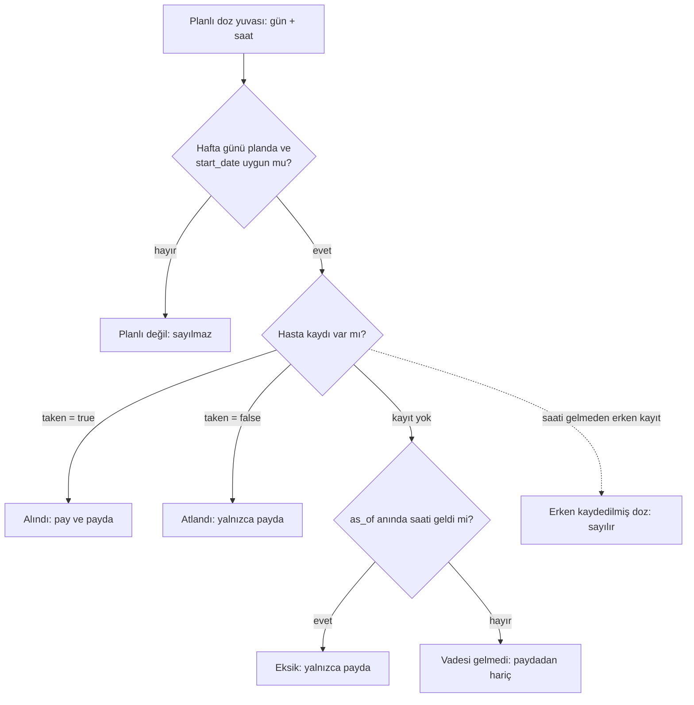

# Uyum Skoru Doğrulaması (M4)

Uyum skoru hekim panosundaki ve koçun hasta özetindeki temel sayıdır. Bu belge tanımı, kuralları, uç durumları ve doğrulama yöntemini anlatır. Kod: `backend/app/services/adherence.py`; testler: `backend/tests/test_adherence.py` (30 test).

## 1. Tanım

```
skor = alınan doz / planlanan doz        (pencere: [start, end], uçlar dahil)
```

- **Planlanan doz**: aktif ilaçların zamanlamalarından (`ScheduleSpec`: saat, hafta günleri, başlangıç tarihi) pencere içindeki her (gün, zamanlama) yuvası için türetilir.
- **Alınan doz**: o yuva için hastanın "aldım" (`taken=True`) kaydı vardır.
- **Atlanmış**: açıkça "almadım" kaydı (`taken=False`). **Eksik**: hiç kayıt yok. İkisi de skoru aynı düşürür; döküm (`skipped` / `missing`) ve `missed_dates` ayrı tutulur.
- `planned = taken + skipped + missing` her zaman geçerlidir.
- Çıktılar: `score` (0..1, 3 basamak), `percent` (tam sayı), ilaç bazında döküm (`by_medication`), kaçırılan günler (`missed_dates`).
- Planlı doz yoksa skor `None` (bant: `veri_yok`); 0 ile karıştırılmaz.

### Doz sınıflandırma akışı



## 2. Pencere kuralları

1. Pencere uçları dahildir (`test_single_day_window`); `end < start` hata verir (`test_invalid_range`).
2. Yuva yalnızca hafta günü planda (`days_of_week`, 1=Pazartesi..7=Pazar) ve `start_date` <= gün ise planlıdır.
3. `as_of` verilmişse, saati henüz gelmemiş yuva paydaya girmez. İstisna: as_of günündeki ve hasta tarafından zaten kaydedilmiş yuva sayılır.
4. `as_of`'tan sonraki günlere ait kayıtlar sayılmaz.
5. `as_of`, ilaç saatlerinin yorumlandığı **yerel duvar saatidir**; saat dilimi bilgisi taşıyan `as_of` ve `tz` verilirse önce `tz`'ye çevrilir (uçtan uca testte `coach.get_adherence`, `Europe/Istanbul` ile doğrulanır).
6. Planda olmayan güne girilmiş kayıt yok sayılır.
7. `score` ve `percent` kesin tamsayı aritmetiğiyle **yarım-yukarı** yuvarlanır.

## 3. Uç durumlar

| Uç durum | Beklenen davranış | Test (`test_adherence.py`) |
|---|---|---|
| Hepsi alındı | 7/7, skor 1.0, %100, kaçırılan gün yok | `test_all_taken` |
| Haftada 3 atlanmış doz (spec senaryosu) | 4/7, 1 skipped + 2 missing, 3 kaçırılan gün | `test_spec_example_three_missed_in_seven_days` |
| Günde iki doz + belirli hafta günleri | planned = 7 + 7 + 3 | `test_twice_daily_and_weekdays` |
| Birden çok ilaç, elle hesap | 12/17 = 0.706, %71, bant orta; ilaç 10 = 0.786, ilaç 20 = 0.333 | `test_multiple_medications_hand_computed` |
| Yalnızca hafta sonu planı | 2 planlı doz | `test_partial_weekdays_weekend_only` |
| Planda olmayan güne kayıt | pay ve payda değişmez | `test_log_on_unscheduled_day_is_ignored` |
| `start_date` pencere içinde | önceki günler sayılmaz | `test_schedule_start_date_respected`, `test_start_date_mid_window_with_weekdays` |
| Bugünün saati gelmemiş dozu (kayıtsız) | paydaya girmez | `test_future_doses_today_excluded` |
| Doz tam `as_of` anında | vadesi gelmiş sayılır | `test_dose_exactly_at_as_of_is_due` |
| Erken kaydedilmiş doz ("aldım" / "almadım") | sayılır (bkz. §4, hata 1) | `test_early_logged_dose_today_counts` |
| `as_of` sonrası güne ait kayıt | sayılmaz | `test_logs_after_as_of_day_are_not_counted` |
| Atlandı vs eksik | skor aynı, döküm farklı | `test_skipped_vs_missing_same_score_different_breakdown` |
| 30 günlük pencere, eşik sınırı | 24/30 = 0.80 -> iyi; 23/30 = 0.767 -> orta | `test_thirty_day_window_hand_computed` |
| Zamanlama yok | skor `None`, bant `veri_yok` | `test_no_schedule_gives_none` |
| Zamanlama pencereden sonra başlıyor | planned 0, skor `None` | `test_schedule_starting_after_window_gives_none` |
| `as_of` pencereden önce | planned 0, skor `None` | `test_as_of_before_window_gives_none` |
| Geçersiz aralık | `ValueError` | `test_invalid_range` |
| Tek günlük pencere | 1/2 -> %50 | `test_single_day_window` |
| Yarım-yukarı yüzde (62.5 -> 63 vb.) | 8 parametreli durum | `test_percent_rounds_half_up` |
| Yarım-yukarı skor (1/16 -> 0.063) | 0.063 | `test_score_rounds_half_up` |
| Yerel 23:45 (UTC 20:45), 23:30 dozu | vadesi geldi, 7 planlı | `test_timezone_late_dose_due_after_conversion` |
| Yerel 23:15 (UTC 20:15) | henüz gelmedi, 6 planlı | `test_timezone_late_dose_not_yet_due` |
| Yerel girdi = dönüştürülmüş UTC | aynı sonuç | `test_timezone_local_input_equivalent_to_converted_utc` |
| `tz` verilmez, aware `as_of` | duvar saati kullanılır (geriye dönük uyum) | `test_timezone_aware_without_tz_uses_wall_clock` |
| Yerel gece yarısından sonra | pencere sonuna kadar tüm dozlar vadesi geçmiş | `test_timezone_after_local_midnight` |
| Uçtan uca saat dilimi (DB) | `coach.get_adherence` UTC "now"u yerel saate çevirir | `test_get_adherence_uses_local_timezone` |
| Bant sınırları | 0.8 iyi, 0.799 orta, 0.6 orta, 0.599 düşük, None veri_yok | `test_bands` |
| Rastgele planlar vs bağımsız referans | 500 tohumlu vaka birebir aynı | `test_property_matches_brute_force_reference` |
| "Alındı" eklemek skoru düşürmez | monotonluk, payda sabit | `test_property_monotonic_in_taken_logs` |

## 4. Doğrulama yöntemi ve bulunan hatalar

Yöntem: (1) elle hesaplanmış örnekler (beklenen değerin hesabı testlerin docstring'inde yazılı); (2) özellik tabanlı karşılaştırma: sabit tohumlu (`20261004`) 500 rastgele plan/kayıt/pencere/`as_of` kombinasyonu, testte **bağımsız yazılmış kaba kuvvet referansıyla** (önce tüm yuvaları listeler, sonra sınıflandırır, `Decimal` ile yuvarlar) karşılaştırılır; (3) değişmezler (`planned = taken + skipped + missing`, 0 <= skor <= 1, monotonluk).

Bulunan ve düzeltilen hatalar:

1. **Erken kaydedilen doz görünmezdi.** Saati henüz gelmemiş dozu hasta erken "aldım" olarak işaretlese bile, saati gelene kadar paydaya ve paya girmiyordu. Artık as_of gününde zaten kaydedilmişse sayılır (kayıtsız ve vadesi gelmemiş doz hâlâ paydaya girmez).
2. **Banker's rounding.** Python `round()` yarımları çift sayıya yuvarlar: `round(62.5) == 62`, `round(0.0625, 3) == 0.062`. Skor ve yüzde için kesin tamsayı aritmetiğiyle yarım-yukarı yuvarlama kullanıldı (5/8 -> %63, 1/16 -> 0.063).
3. **Saat dilimi.** UTC `as_of`, yerel duvar saatiyle yazılmış ilaç saatleriyle doğrudan karşılaştırılıyordu; gece geç saatlerde doz vadesi yanlış hesaplanıyordu. Aware `as_of` artık zamanlama saat dilimine (`tz`) çevrilerek karşılaştırılır.

## 5. Band eşikleri

| Band | Koşul |
|---|---|
| `iyi` | skor >= %80 |
| `orta` | %60 <= skor < %80 |
| `dusuk` | skor < %60 |
| `veri_yok` | planlı doz yok (`None`) |

Gerekçe: >= %80 eşiği, ilaç uyumu literatüründe PDC (proportion of days covered) ve MPR (medication possession ratio) ölçümlerinde "uyumlu" için yaygın kullanılan sınırdır; WHO'nun 2003 tarihli uzun süreli tedavilerde uyum raporu da uyumsuzluğun kapsamını bu çerçevede ele alır. %60 alt sınırı klinik bir kesinlik değil, hekim panosunda "yakından izle" ile "müdahale gerek" ayrımını yapan **pratik bir eşiktir**. Bantlar tıbbi karar değil, hekimin dikkatini yönlendiren bir görselleştirmedir. Eşik değerleri ve literatür atıfları danışman hekim tarafından gözden geçirilmelidir. Sınır davranışı `test_bands` ve `test_thirty_day_window_hand_computed` ile sabitlenmiştir (0.8 dahil "iyi").

## 6. Sınırlılıklar

- **Öz bildirim yanlılığı**: "aldım" hasta beyanıdır, doğrulanmamıştır (akıllı kutu, eczane dolum verisi vb. yok). Sosyal beğenirlik nedeniyle skor gerçek uyumu olduğundan yüksek gösterebilir.
- **Doz zamanı tolerans penceresi yok**: Doz tarihine göre sayılır; 08:00'de planlanan doz 14:00'te alınsa da "alındı"dır. Dozun doğru saatte alınıp alınmadığı ölçülmez.
- **Aktif olmayan ilaçlar hariç**: Durdurulmuş ilaçlar skora girmez; ilaç bırakılmışsa geçmiş dönem skoru bu durumu yansıtmaz.
- **Yalnızca doz sayısı**: Doz miktarı ve ilacın klinik önemi ağırlıklandırılmaz; tüm dozlar eşit sayılır.
- **Veri girişine bağımlılık**: Kayıt girmeyen hasta "eksik" sayılır; gerçek bir kaçırma ile unutulmuş kayıt ayırt edilemez.
- **Doğrulama kapsamı**: Testler hesaplama mantığının doğruluğunu gösterir; eşiklerin klinik geçerliliğini ya da skorun gerçek klinik sonuçlarla ilişkisini göstermez.

## Ekran görüntüleri

Hekim panosunda uyum skoru, 30 günlük doz takvimi ve hastanın Bugün kartı:


*Şekil: İlaç uyumu (7 ve 30 gün) ve 30 günlük doz takvimi.*


*Şekil: Hastanın Bugün kartı; doz kayıtları uyum skorunun girdisidir.*
