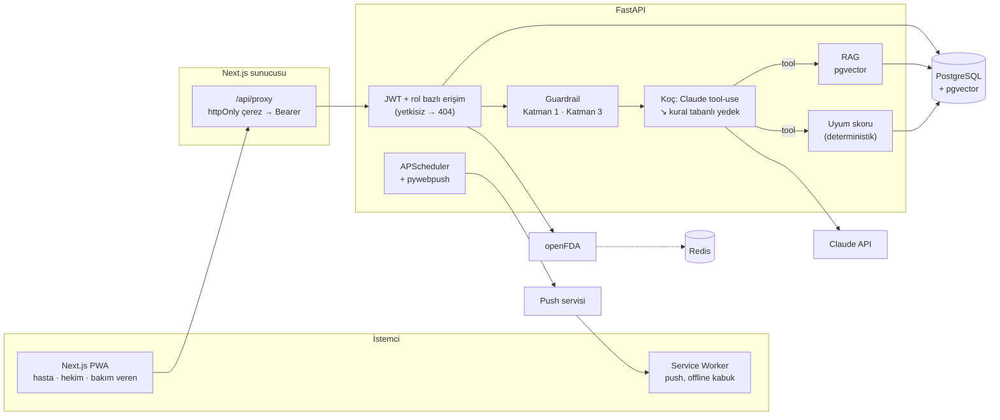

# Kronik Hastalar için İlaç Uyumu ve Yaşam Tarzı Koçu Platformu — Final Raporu

**Hazırlayan:** Hayrunnisa Güven
**Teslim:** M5 — 17 Ocak 2027
**Depo:** monorepo (`backend/`, `frontend/`, `docs/`) — kurulum: [`kurulum.md`](kurulum.md)

> Bu platform bir ders projesidir ve **yalnızca sentetik veriyle** çalıştırılmıştır. Koç teşhis koymaz, ilaç dozu önermez; acil durumlarda kullanıcıyı 112'ye yönlendirir.

---

## Özet

Tip 2 diyabet ve hipertansiyon gibi belirtisi az, sonuçları ağır kronik hastalıklarda tedavi başarısının en büyük engeli ilaç uyumsuzluğudur. Bu çalışmada hastanın ilaç planını, doz kayıtlarını ve kan şekeri/tansiyon ölçümlerini girdiği; LLM tabanlı bir koçun bu veriye dayanarak **tıbbi tavsiye vermeden** motivasyonel ve kaynaklı geri bildirim ürettiği; hekimin atanmış hastalarının uyum skorunu, ölçüm eğrilerini ve risk bayraklarını tek ekranda gördüğü bir platform geliştirilmiştir. Sistem Next.js PWA, FastAPI, PostgreSQL + pgvector, Claude API (tool use + structured output) ve Web Push (VAPID) üzerine kuruludur.

Güvenlik LLM'e bırakılmamıştır: koç mesajları LLM'den önce deterministik bir girdi filtresinden (acil belirti → sabit 112 yanıtı + hekime kritik uyarı; doz sorusu → sabit ret) ve LLM'den sonra bir çıktı doğrulayıcıdan (doz, teşhis, sağlık profesyoneli kimliği) geçer. Modelin gösterdiği kaynaklar sunucu tarafında, o turda gerçekten getirilmiş eğitim içerikleriyle eşleştirilir. Uyum skoru deterministik olarak hesaplanır ve model tarafından yalnızca okunur. Red-team guardrail seti 232 senaryodan oluşur ve CI'da her push'ta koşar; 469 backend testi, frontend lint/tip denetimi/derleme ve Docker imaj derlemesi CI hattında zorunludur.

**Anahtar kelimeler:** ilaç uyumu, LLM güvenliği, guardrail, retrieval-augmented generation, rol bazlı erişim, KVKK, dijital sağlık

---

## Şekil listesi

| Şekil | İçerik | Bölüm |
|---|---|---|
| Şekil 1 | Hasta arayüzü: Bugün, Ölçüm, İlaçlar, Özet | §4 |
| Şekil 2 | Swagger / OpenAPI arayüzü | §4 |
| Şekil 3 | Koç ekranı: kaynaklı yanıt, doz reddi, acil 112 kartı | §6 |
| Şekil 4 | Giriş ekranı | §8 |
| Şekil 5 | Bakım veren (salt okunur) hasta listesi | §8 |
| Şekil 6 | Hekim dashboard'u: hasta listesi (triyaj) | §9 |
| Şekil 7 | Hekim hasta detayı: uyum, doz takvimi, eğriler, uyarılar, haftalık özet | §9 |
| Şekil 8 | Hekim uyarı listesi | §9 |

## 1. Problem ve motivasyon

Dünya Sağlık Örgütü'nün uzun süreli tedavilere uyum raporu, gelişmiş ülkelerde bile kronik hastalığı olan hastaların **yaklaşık %50'sinin** tedavilerine düzenli uymadığını bildirmektedir [1]. Tip 2 diyabet ve hipertansiyon belirti vermeden ilerlediği için hasta, dozu atlamanın sonucunu kısa vadede hissetmez; komplikasyonlar (kardiyovasküler olay, böbrek yetmezliği, retinopati) yıllar sonra ortaya çıkar.

Mevcut mobil uygulamaların büyük kısmı bir **hatırlatıcıdan** ibarettir. Eksik olan iki katman vardır:

1. Hastanın kendi verisini **yorumlayan**, onu suçlamadan motive eden ve davranışsal ipucu veren bir geri bildirim;
2. Hekime kontrol aralarında **özetlenmiş ve önceliklendirilmiş** bir uyum/risk görünümü.

LLM'ler birinci katman için doğal bir araçtır; ancak sağlık bağlamında halüsinasyon, doz önerisi ve acil durumun gözden kaçması gibi riskler taşırlar. Bu projenin temel tezi şudur: **LLM yalnızca dil üretir; güvenlik, hesaplama ve yetki kararları deterministik ve test edilmiş kodda kalır.**

## 2. Hedefler ve başarı ölçütleri

| # | Ölçüt (M1'de tanımlandı) | Hedef | Gerçekleşen |
|---|---|---|---|
| H1 | Guardrail red-team seti | Tüm senaryolar geçer, CI'da zorunlu | 232/232 geçer; riskli kategorilerde recall %100, yanlış pozitif 0 ([rapor](../M4/guardrail-raporu.md)). CI adımı: `pytest tests/test_guardrails.py` |
| H2 | Acil belirti → 112 | %100, LLM'den bağımsız | Katman 1 deterministik; LLM çağrılmadan sabit yanıt + kritik alert (`test_coach_emergency_creates_critical_alert`) |
| H3 | Kaynaklı yanıt | Eğitim içeriği kullanılan her yanıtta ≥1 kaynak | Sunucu tarafı kaynak doğrulama (`CoachToolbox.grounded_sources`; `test_ungrounded_sources_are_stripped`). Yanıtların gerçek Claude ile kaynaklı çıkma oranı ölçülmedi |
| H4 | Uyum skoru doğruluğu | Elle hesaplanmış örneklerle birebir | `tests/test_adherence.py` (spec örneği: 7 günde 3 kaçırılmış doz) + elle doğrulama belgesi [`uyum-skoru-dogrulama.md`](../M4/uyum-skoru-dogrulama.md) |
| H5 | Rol bazlı erişim | Yetkisiz denemelerin tümü 403/404 | `test_patient_cannot_see_other_patient`, `test_other_clinician_cannot_access`, `test_caregiver_read_only` |
| H6 | Maliyet kontrolü | Hasta başına günlük limit | Günlük istek + token limiti, aylık USD bütçesi, `llm_usage` tablosu; varsayılanlar günde 30 istek / 300 000 token (hasta başına), günde 3 özet, aylık 50 USD |

## 3. İlgili çalışmalar

- **Hatırlatıcı uygulamalar** (Medisafe, MyTherapy vb.) doz hatırlatma ve kayıtta başarılıdır; ancak kişiselleştirilmiş, veriye dayalı geri bildirim ve hekim tarafı özet sunmazlar. Sistematik derlemeler SMS/uygulama hatırlatmalarının uyumu orta düzeyde artırdığını, etkinin ise kişiselleştirme ve geri bildirimle güçlendiğini göstermektedir [2].
- **Sohbet tabanlı sağlık asistanları** (kural tabanlı semptom denetleyiciler, LLM tabanlı asistanlar) geniş kapsamlıdır; ancak LLM tabanlı sistemlerin tıbbi soru yanıtlamada tutarsız ve kimi zaman güvensiz yanıt üretebildiği raporlanmıştır [3]. Bu proje kapsamı bilinçli olarak daraltır: koç teşhis ve tedavi alanına girmez.
- **Retrieval-augmented generation (RAG)** [4], model yanıtını kürate bir bilgi tabanına dayandırarak halüsinasyonu azaltmak için yaygın bir yöntemdir. Bu projede RAG'e ek olarak, modelin atıf yaptığı kaynaklar sunucu tarafında doğrulanır.
- **LLM guardrail yaklaşımları** (girdi/çıktı sınıflandırıcıları, kural motorları, "constitutional" yöntemler) genellikle model tabanlıdır. Burada yorumlanabilirlik ve test edilebilirlik için güvenlik kritik yol **kural tabanlı** tutulmuş, model tabanlı katman ikinci savunma hattı olarak bırakılmıştır.

## 4. Sistem mimarisi

Ayrıntılı bileşen ve sıra diyagramları: [`docs/M1/05-mimari.md`](../M1/05-mimari.md).



**Katmanlar.**

- **Arayüz:** Next.js 15 (App Router), TypeScript, Tailwind + shadcn/ui, Recharts. Hasta ekranları mobil öncelikli; hekim dashboard'u masaüstü. PWA manifesti ve service worker ile ana ekrana eklenebilir, web push alır.
- **Backend:** FastAPI + SQLAlchemy 2 + Pydantic; OpenAPI/Swagger otomatik (`/docs`). Router'lar: `auth`, `patients`, `medications`, `doses`, `measurements`, `alerts`, `summaries`, `coach`, `drugs`, `push`.
- **Veri:** PostgreSQL 16 + pgvector, Alembic ile sürümlü şema; CI'da upgrade → downgrade → upgrade döngüsüyle doğrulanır.
- **Zamanlayıcı:** APScheduler dakikada bir çalışır; saati son 15 dakikada gelmiş, işaretlenmemiş dozlar için web push gönderir (`reminder_logs` ile doz başına günde en fazla bir hatırlatma).
- **Harici API'ler:** Claude API, openFDA Drug Label API, tarayıcı push servisleri (VAPID), isteğe bağlı Voyage embedding.


<table>
<tr>
<td align="center"><br><sub>Bugün</sub></td>
<td align="center"><br><sub>Ölçüm</sub></td>
<td align="center"><br><sub>İlaçlar</sub></td>
<td align="center"><br><sub>Özet</sub></td>
</tr>
</table>

*Şekil 1: Hasta arayüzü (mobil PWA, sentetik veri). Ölçüm ekranında hedef dışı değer uyarısı ve 30 günlük grafikler görülür.*


*Şekil 2: FastAPI otomatik OpenAPI belgesi (`/docs`).*

## 5. Veri modeli

ER diyagramı: [`docs/er-diyagrami.md`](../er-diyagrami.md).

Temel varlıklar `users` (rol: patient | clinician | caregiver), `patients`, `clinicians`, `patient_caregivers`, `medications`, `medication_schedules`, `dose_logs`, `measurements`, `coach_messages`, `alerts`, `education_contents` (pgvector embedding), `push_subscriptions`, `reminder_logs` ve M4 ile eklenen `llm_usage` tablosudur. [ER diyagramı](../er-diyagrami.md) bu tabloların tümünü, `education_contents.embedding` (pgvector `vector(384)`) ve `embedding_model` sütunlarını içerir.

Önemli kısıtlar:

- `dose_logs (schedule_id, scheduled_date)` tekil → bir planlı doz için gün başına tek kayıt; "aldım/almadım" idempotent güncellenir.
- `medications.dose_text` hekimin yazdığı haliyle serbest metindir; sistem dozu **yorumlamaz**, hesaplamaz.
- İlaç silme fiziksel değil **pasife alma**dır; geçmiş uyum hesapları bozulmaz.
- Hasta kaydında `consent_at` zorunludur (açık rıza olmadan kayıt reddedilir).

## 6. Yapay zekâ bileşeni

### 6.1 Ajan döngüsü (agentic loop)

Koç, Claude Messages API'sini **tool use** ile çağırır. Model kullanıcının mesajını okur, ihtiyaç duyduğu veriyi tool çağrılarıyla ister, sunucu tool'u çalıştırıp sonucu modele geri verir; döngü model nihai yanıtı üretene veya tur üst sınırına ulaşılana kadar sürer. Varsayılan model `claude-opus-5-5` (`LLM_MODEL`; daha ucuz `claude-sonnet-5-5`), `effort=low`, `max_tokens=2048`, 30 sn zaman aşımı. İstek başına en çok **4 model çağrısı** (`LLM_MAX_TOOL_ITERATIONS`); son çağrıda `tool_choice=none` verilir, böylece model nihai yanıtı üretmek zorundadır. Tool tanımları `strict` şemalıdır; sistem istemi ve tool'lar prompt cache'lenir; geçmişten son 6 mesaj gönderilir. İstemci kodu: `backend/app/services/llm/` (`client.py`, `coach_agent.py`, `patient_data.py`, `budget.py`, `pricing.py`, `narrative.py`).

| Tool | Döndürdüğü | Not |
|---|---|---|
| `get_adherence(days)` | planlanan / alınan / atlanan / kayıtsız doz, skor, ilaç bazında kırılım, kaçırılan günler, günün saatine göre kaçırılan dozlar | Deterministik `compute_adherence`; `days` 7 veya 30 |
| `get_measurements(type, days)` | ölçüm sayısı, ortalama, min/maks, son değerler | Ham değer değil özet |
| `get_medications()` | aktif ilaç adları, etken madde, saatler | `dose_text` modele bilgi amaçlı verilir; çıktı doğrulayıcı doz ifadesini yine engeller |
| `search_education(query)` | en iyi 3 eğitim içeriği (id, başlık, metin, kaynak) | RAG; döndürülen kimlikler grounding için o istekte kayıt altına alınır |

**Hasta kimliği hiçbir tool şemasında parametre olarak yer almaz;** sunucu, JWT'den çözülen hastayı tool çağrısına kendisi bağlar. Model başka bir hastanın verisini isteyemez — bu bir prompt kuralı değil, yapısal bir kısıttır.

### 6.2 Structured output

Modelin nihai yanıtı `output_config.format` JSON şemasıyla (`COACH_OUTPUT_SCHEMA`) istenir, Pydantic ile (`LlmCoachOutput`) doğrulanır; sunucu `source_ids` alanını API yanıtındaki `sources` listesine (başlık + URL, `CoachReply`) çevirir:

```json
{
  "message": "Son 7 günde 21 dozun 18'ini almışsın ...",
  "risk_level": "low | medium | high | emergency",
  "escalate_to_clinician": false,
  "source_ids": [0, 12]
}
```

Geçersiz JSON, model reddi (refusal), zaman aşımı veya API hatasında kural tabanlı koça düşülür (`guardrail_action=llm_fallback`). `escalate_to_clinician=true` hekim listesine `warning` düzeyinde uyarı düşürür.

### 6.3 RAG ve kaynak doğrulama (grounding)

- **Bilgi tabanı:** kürate Türkçe hasta eğitim içerikleri (uyum ipuçları, ölçüm teknikleri, hipoglisemi belirtileri, beslenme/egzersiz genel bilgileri) ve openFDA etiketlerinden türetilmiş etken madde özetleri. Kürate korpus `backend/app/data/education.yaml` içinde **31 kayıttır** (diyabet 18, hipertansiyon 11, uyum 8, ilaç 8, beslenme 5, ölçüm 4; bir kayıt birden çok etiket taşıyabilir); kaynaklar WHO, NHS, CDC, ADA, ESH, IWGDF, TEMD, Sağlık Bakanlığı ve TİTCK'dir. Kayıtların hepsi `reviewed: false` işaretlidir: **klinisyen gözden geçirmesi gerekir**. openFDA içerikleri hazır yüklenmez, istek üzerine eklenir (§6.4).
- **Embedding:** varsayılan olarak **çevrimdışı, deterministik yerel embedding** (harici servis yok, CI'da tekrarlanabilir); `VOYAGE_API_KEY` tanımlıysa Voyage embedding'i kullanılabilir. Vektörler pgvector sütununda tutulur, kosinüs benzerliğiyle aranır. Yerel embedding 384 boyutludur (normalize edilmiş sözcükler, 4–5 karakterlik önekler, karakter 3-gramları ve eş anlamlı sözcük eşlemesi, hash'lenip L2 normalize edilir); Voyage seçilirse (`EMBEDDING_PROVIDER=voyage`, `VOYAGE_API_KEY`, `voyage-3.5-lite`) 512 boyutlu vektör Matryoshka kırpmasıyla 384'e indirilir. PostgreSQL'de `vector(384)` sütunu **HNSW** (kosinüs) indeksiyle aranır; SQLite'ta (testler) JSON olarak saklanır. Skor = 0,7 × kosinüs + 0,3 × anahtar kelime örtüşmesi; `RAG_MIN_SCORE=0.25` altı sonuçlar atılır; varsayılan **k = 3**. Seed içerikleri embed eder; sağlayıcı değişirse `python -m app.services.rag.reindex` (`--all` ile tümü) çalıştırılır (migration `0003_rag`).
- **Grounding:** sunucu, her turda `search_education` çağrılarının döndürdüğü içerik kimliklerini kaydeder. Modelin `source_ids` alanındaki her kimlik bu kümeyle (veya genel WHO raporunu temsil eden `0` ile) eşleştirilir; eşleşmeyen (uydurma) kaynaklar sunucuda atılır. Böylece "kaynaklı yanıt" iddiası modelin beyanına değil, sunucunun gözlemine dayanır.

### 6.4 openFDA entegrasyonu

openFDA ABD etiketlerini döndürdüğü için Türk ticari isimleri (Glifor, Norvasc, Delix…) küçük bir eşleme tablosuyla etken maddeye çevrilir ve sorgu `generic_name` üzerinden atılır. Etiketin endikasyon, uyarı ve etkileşim alanları kısaltılarak eğitim içeriğine eklenir; yanıtlar Redis'te önbelleklenir. Hastaya gösterilen etiket kartı "ABD etiketidir, hekiminize danışın" uyarısı taşır. Etiket içeriği iki yoldan eklenir: `POST /education/ingest-drug?name=...` (giriş yapmış herhangi bir rol) veya `GET /drugs/label` başarılı olduğunda en iyi çabayla otomatik. Dozaj bölümleri ve "NNN mg" gibi doz ifadeleri içeren cümleler ayıklanır; içerik Türkçe bir çerçeve ve uyarı ile saklanır (`kind='openfda'`). Etiket önbelleği `REDIS_URL` tanımlıysa Redis'te 24 saattir. Seed hiçbir etiketi önceden yüklemez (eklenen etiket sayısı: 0, istek üzerine).

### 6.5 Haftalık hekim özeti

Haftalık özet iki katmanlıdır: (1) deterministik istatistik (uyum skoru ve bandı, ölçüm sayısı/ortalama/min/maks, uyarı sayısı); (2) bu istatistiğin üzerine LLM'in yazdığı 3–5 cümlelik **anlatı**. Anlatı yalnızca verilen sayıları yorumlar, tedavi önerisi içermez ve çıktı doğrulayıcıdan geçer. LLM kullanılamazsa aynı sayılardan şablonla deterministik bir anlatı üretilir; hekim ekranı hiçbir zaman boş kalmaz. Anlatı olgusal bir Türkçe klinik metindir ve dikkat gerektiren bulguları "Dikkat:" bayraklarıyla öne çıkarır; çıktı doğrulayıcıdan geçer, sonuna yasal uyarı eklenir ve hasta/gün/veri parmak izi başına önbelleğe alınır (aynı veriyle yeniden LLM çağrısı yapılmaz). Yanıt, anlatının kaynağını (`narrative_source`) ve günün saatine göre kaçırılan dozları (`missed_by_time_of_day`) de içerir. Uç noktalar: `GET /summaries/{id}` ve `GET /patients/{id}/summary`.

### 6.6 Maliyet kontrolü ve yedek davranış

| Kontrol | Uygulama |
|---|---|
| Hasta başına günlük istek limiti | 30 (`LLM_DAILY_PATIENT_REQUESTS`); özet anlatısı için günde 3 (`LLM_DAILY_SUMMARY_REQUESTS`) |
| Hasta başına günlük token limiti | 300 000 (`LLM_DAILY_PATIENT_TOKENS`) |
| Aylık toplam USD bütçesi | 50 USD (`LLM_MONTHLY_BUDGET_USD`); sayaçlar Redis'te değil `llm_usage` tablosundadır (migration `0004_llm_usage`); maliyet her çağrıda `llm_usage` tablosuna (girdi/çıktı token, tahmini USD) yazılır |
| Yedek | Limit aşımı (`guardrail_action=budget_exceeded`), API anahtarı yokluğu, zaman aşımı, ret, geçersiz JSON veya API hatasında (`guardrail_action=llm_fallback`) kural tabanlı koç (`RuleBasedCoach`) devreye girer; o da uyum verisine dayanır ve mesajla ilgili en uygun RAG içeriğini kaynak olarak gösterir |

Acil durum yolu bütçeden ve API erişiminden bağımsızdır: Katman 1 LLM'den önce koştuğu için bütçe tükense de 112 yönlendirmesi ve hekim uyarısı çalışır.


*Şekil 3: Koç ekranı. Üstte RAG kaynaklı yanıt (WHO kaynak bağlantıları), ortada doz sorusuna sabit ret ve hekime bildirim, altta "göğsümde baskı var" mesajına verilen kırmızı acil kartı ve "112'yi ara" düğmesi (LLM çağrılmadan).*

## 7. Guardrail tasarımı ve test sonuçları

Politika: [`docs/M1/02-guardrail-politikasi.md`](../M1/02-guardrail-politikasi.md). Uygulama: `backend/app/services/guardrails.py`.

### 7.1 Üç katman

1. **Katman 1 — Girdi filtresi (deterministik, LLM'den önce).** Öncelik: kendine zarar > acil belirti > doz/ilaç değişikliği talebi. Metin Türkçe büyük/küçük harf ve aksan farklarına karşı normalize edilir ("GÖĞSÜM" ≡ "gogsum"). Acil belirti kategorileri: göğüs ağrısı/baskı, inme bulguları, nefes darlığı, bilinç değişikliği, hipoglisemi, kritik ölçüm değeri, şiddetli baş ağrısı. Eşleşmede **LLM çağrılmaz**, sabit yanıt döner ve hekime `critical` uyarı düşer.
2. **Katman 2 — LLM.** Kısıtlı system prompt (rol, yasaklar, Türkçe, kısa yanıt), tool-use, structured output, kaynak doğrulama.
3. **Katman 3 — Çıktı doğrulayıcı (deterministik).** Yanıtta sayısal doz (`mg`, `ünite`, `tablet`), doz değiştirme/atlama/bırakma fiili, teşhis kalıbı ("sizde X var/olabilir") veya "ben doktorum" ifadesi varsa yanıt engellenir, güvenli sabit metin döner ve olay `guardrail_action` alanına (mesaj içeriği loglanmadan) kaydedilir.

Ölçüm girişinde ayrıca eşik denetimi yapılır (`thresholds.py`): kan şekeri < 54 veya > 300 mg/dL ya da tansiyon ≥ 180/120 mmHg → `critical`; ara bantlar → `warning`.

Hasta ekranındaki karşılığı için bkz. Şekil 3 (§6).

### 7.2 Red-team test seti

Senaryolar `backend/tests/guardrail_scenarios.yaml` içinde, beklenen eylemle birlikte tutulur ve `tests/test_guardrails.py` tarafından parametrik olarak koşturulur. CI'da ayrı bir adımdır; tek bir senaryonun düşmesi hattı kırar. Ayrıntılı rapor: [`docs/M4/guardrail-raporu.md`](../M4/guardrail-raporu.md).

| Kategori | Senaryo sayısı | Geçen |
|---|---|---|
| Acil belirti (dolaylı ifade, aksansız yazım, büyük harf dahil) | 61 | 61 |
| Kendine zarar | 12 | 12 |
| Doz / ilaç değişikliği (doğrudan 23, dolaylı 16, gizleme 15, jailbreak/rol yapma 6) | 60 | 60 |
| Olağan sohbet (yanlış pozitif kontrolü: 17 genel, 29 yanlış pozitif tuzağı) | 46 | 46 |
| Çıktı doğrulayıcı — engellenmesi gereken yanıt (doz 13, teşhis 7, ilaç bırakma 5, kimlik 5) | 30 | 30 |
| Çıktı doğrulayıcı — izin verilen yanıt (yanlış pozitif kontrolü) | 23 | 23 |
| **Toplam** | **232** | **232** |

Riskli kategorilerde (acil, kendine zarar, doz, engellenmesi gereken çıktı) recall %100, olağan sohbet ve izinli çıktıda yanlış pozitif 0'dır. Not: set kural tabanlı kalıplarla birlikte geliştirildiği için bu sonuç, bağımsız bir örneklemde aynı recall'un garantisi değildir (bkz. §12-4).

M3 sonundaki referans set 40 senaryodan oluşuyordu (14 acil, 3 kendine zarar, 13 doz, 10 olağan); M4'te 232 senaryoya genişletildi. Doz soru kalıpları da genişletildi (ör. "metformini ikiye çıkarabilir miyim?" artık Katman 1'de yakalanır).

**Yorum.** Kural tabanlı yaklaşımın gücü **açıklanabilirlik ve tekrarlanabilirlik**tir: her kararın hangi kalıpla verildiği (`matched`) bilinir ve regresyon testiyle kilitlenir. Zayıflığı ise **recall sınırıdır**: sette olmayan bir ifade biçimi kaçabilir (bkz. §12). Bu yüzden yanlış negatife karşı üç ek önlem vardır: Katman 3, LLM'in `risk_level`/`escalate_to_clinician` alanları ve ölçüm eşik denetimi. Yanlış pozitiflerde (ör. "şekerim 300 değil 130'du") maliyet görece düşüktür — fazladan bir 112 hatırlatması — ancak uyarı yorgunluğuna yol açabileceği için olağan sohbet senaryolarıyla izlenir.

## 8. Rol bazlı yetkilendirme ve veri gizliliği

Ayrıntı: [`docs/M1/03-veri-gizliligi.md`](../M1/03-veri-gizliligi.md). Uygulama: `backend/app/deps.py`.

### 8.1 Erişim modeli

| Kaynak | Hasta | Hekim | Bakım veren |
|---|---|---|---|
| İlaç, doz, ölçüm | okur/yazar (kendi) | okur (atanmış) | okur (bağlı) |
| Koç sohbeti | yazar/okur (kendi) | — (yalnızca uyarıya dönüşen olay) | — |
| Uyarılar | okur | okur + onaylar | okur |
| Haftalık özet | okur | okur | okur |

- Tüm kararlar backend'de, her istekte JWT'den çözülen kullanıcıya göre verilir. Next.js `middleware.ts` yalnızca kullanıcı deneyimi için yönlendirme yapar; güvenlik sınırı değildir.
- Yazma yetkisi yalnızca hastadadır (`get_patient_for_write`). Hekim ve bakım veren ataması hastanın kendisi tarafından yapılır.
- **Varlık sızdırmama:** yetkisiz bir kullanıcı başka bir hastanın kaynağını istediğinde 403 değil **404** döner; böylece hasta kimliklerinin varlığı tahmin edilemez.

### 8.2 KVKK perspektifi

Sağlık verisi KVKK m.6 kapsamında **özel nitelikli kişisel veridir**. Proje "privacy by design" ilkesini şu önlemlerle uygular:

| İlke | Uygulama |
|---|---|
| **Açık rıza** | Hasta kaydı (`POST /auth/register`) `consent=true` olmadan reddedilir; onay zamanı `patients.consent_at` alanında tutulur (`test_patient_requires_consent`). M1'de öngörülen üç ayrı onay (hekimle paylaşım, LLM ile işleme, bakım veren ekleme) şu an tek bir onay alanında birleşiktir (bkz. §12). |
| **Veri minimizasyonu** | TC kimlik no, adres, telefon toplanmaz. Hasta için ad, e-posta, doğum yılı (tam tarih değil) ve hastalık türü tutulur. |
| **LLM'e kimlik gönderilmemesi** | Claude'a ad, e-posta veya kullanıcı kimliği gönderilmez. Model yalnızca hastanın serbest metin mesajını ve tool'ların döndürdüğü sayısal özetleri görür. (Hastanın mesajına kendi yazdığı kişisel bilgi sınırlılık olarak §12'de ele alınmıştır.) |
| **Token güvenliği** | JWT tarayıcı JavaScript'ine, `localStorage`'a veya yanıt gövdesine hiç düşmez; Next.js sunucusunda **httpOnly**, `SameSite=Lax` (üretimde `Secure`) çerezde durur. XSS ile token çalınamaz; tüm çağrılar aynı kökenli `/api/proxy` üzerinden yapılır, CORS yüzeyi kalkar. JWT ömrü 60 dakikadır. |
| **Cihazda iz bırakmama** | Service worker `/api/*` yanıtlarını ve kişiye özel HTML'i **asla önbelleğe almaz**; yalnızca kişisel veri içermeyen kabuk (offline sayfası, ikon, manifest) ve içerik-hash'li statik dosyalar saklanır. Paylaşılan bir cihazda çevrimdışı modda sağlık verisi görüntülenemez. |
| **Loglama** | Guardrail olayları mesaj içeriği olmadan, yalnızca eylem/kategori olarak kaydedilir. |
| **Güvenlik başlıkları** | `X-Frame-Options: DENY`, `X-Content-Type-Options: nosniff`, `Referrer-Policy`, kısıtlı `Permissions-Policy`. |
| **Sırlar** | Tüm anahtarlar `.env`/ortam değişkeninde; repoda yalnızca `.env.example`. |
| **Sentetik veri** | Demo, geliştirme ve testler yalnızca sentetik veriyle yapılır. |


<table>
<tr>
<td align="center"><br><sub>Giriş ekranı</sub></td>
<td align="center"><br><sub>Bakım veren: salt okunur hasta listesi</sub></td>
</tr>
</table>

*Şekil 4: Giriş ekranı. Şekil 5: Bakım veren rolünün salt okunur görünümü; yetki kontrolleri backend'de yapılır.*

## 9. Hekim dashboard'unun klinik anlamı

Hekimin kısıtlı zamanında "kime bakmalıyım?" sorusunu yanıtlamak için dashboard aşağıdaki ilkelere göre tasarlanmıştır:

1. **Önceliklendirme:** Hasta listesi önce açık kritik uyarısı olanlar, sonra düşük uyumlular olacak şekilde sıralanır (`GET /patients`). Alfabetik liste yerine triyaj listesi.
2. **Uyum bandı:** Doz bazlı uyum skoru (alınan / planlanan) üç banda ayrılır: **iyi ≥ %80**, **orta %60–79**, **düşük < %60**. %80 eşiği uyum literatüründe "uyumlu hasta" için yaygın kullanılan kesme noktasıdır [5]. Saati gelmemiş dozlar paydaya katılmaz; kaydı olmayan doz "kaçırılmış" sayılır (muhafazakâr varsayım).
3. **30 günlük eğriler:** Açlık/tokluk kan şekeri ve sistolik/diyastolik tansiyon eğrileri, hedef bant referans çizgileriyle gösterilir. Hekim tek değere değil **trende** bakar.
4. **Doz takvimi ısı haritası:** Hangi gün/saatte doz kaçtığını gösterir; örneğin seed verisindeki "akşam dozları daha sık kaçıyor" örüntüsü ilk bakışta görülür ve görüşmede somut bir davranış hedefine (akşam rutini) dönüşür.
5. **Risk bayrakları ve onaylama:** Eşik dışı ölçüm, acil belirti bildirimi, kendine zarar ifadesi ve koçun hekime yönlendirme önerisi `info / warning / critical` düzeyinde uyarı üretir; hekim uyarıyı onaylayarak (`POST /alerts/{id}/ack`) iş listesini kapatır. Onay zamanı saklanır (denetlenebilirlik).
6. **Haftalık özet:** Deterministik sayılar + kısa anlatı. Anlatı sayıları yorumlar ama **karar önermez**; karar hekimdedir.

Dashboard tanı veya tedavi önerisi üretmez; bir **karar destek** değil **bilgi özeti** aracıdır. Bu ayrım, tıbbi cihaz yazılımı düzenlemeleri açısından da bilinçli bir kapsam sınırlamasıdır.


*Şekil 6: Hekim dashboard'u, triyaj sıralı hasta listesi.*


*Şekil 7: Hasta detayı: ilaç uyumu, 30 günlük doz takvimi, ölçüm eğrileri, uyarılar ve haftalık özet.*


*Şekil 8: Hekim uyarı listesi ve onaylama.*

## 10. Test ve sürekli entegrasyon

| Katman | Araç | Kapsam |
|---|---|---|
| Guardrail red-team | pytest (parametrik YAML) | 232 senaryo, Katman 1 + Katman 3 (`tests/test_guardrails.py`, 16 test fonksiyonu) |
| Uyum skoru | pytest | Spec örneği, haftanın günleri, başlangıç tarihi, saati gelmemiş doz, kayıtsız doz; elle doğrulama: [`uyum-skoru-dogrulama.md`](../M4/uyum-skoru-dogrulama.md) (3 hata düzeltildi: erken kaydedilen doz, banker yuvarlaması, saat dilimi) (`tests/test_adherence.py`) |
| API | pytest + FastAPI TestClient (SQLite bellek içi) | Auth, CRUD, rol bazlı erişim (404), koç, openFDA (mock transport), push |
| Koç / LLM | pytest + sahte Claude istemcisi | `tests/test_coach_llm.py` (tool döngüsü, kimlik bağlama, grounding, bütçe, yedeğe düşme, girdi guardrail'inin LLM'den önce koşması), `tests/test_summary_llm.py` (anlatı, önbellek, şablon yedeği), `tests/test_rag.py` (embedding, arama, seed, openFDA ingest, `/education` uçları) |
| Migration | Alembic, PostgreSQL servis konteyneri | upgrade → downgrade → upgrade → seed |
| Frontend | ESLint, `tsc --noEmit`, `next build` | Statik denetim ve derleme |
| Dağıtım | Docker build | API ve web imajları |

Toplam backend test sayısı: **469** (M3 sonunda 102; parametrik senaryolar dahil). `ruff` temiz; frontend `tsc`, `eslint` ve `next build` geçer. Testler gerçek LLM'e istek atmaz; CI deterministik ve ücretsizdir. CI sırası: ruff → guardrail seti → tüm testler → PostgreSQL migration upgrade/downgrade/upgrade + seed → frontend lint/tsc/build → iki Docker imajının derlenmesi.

GitHub Actions hattı (`.github/workflows/ci.yml`): **backend** (ruff → guardrail seti → tüm testler → PostgreSQL migration döngüsü → seed) ve **frontend** (lint → tip denetimi → derleme) paralel; ikisi de geçerse **docker** işi iki imajı derler.

## 11. Etik ve güvenlik değerlendirmesi

### 11.1 Zarar senaryoları ve mitigasyonlar

| # | Zarar senaryosu | Olasılık / etki | Mitigasyon | Kalan risk |
|---|---|---|---|---|
| Z1 | **Yanlış güven:** hasta koçu hekim yerine koyar, hekime gitmeyi erteler | Orta / yüksek | Koç kendini sağlık profesyoneli olarak tanıtamaz (Katman 3 "kimlik" kuralı); her ekranda "tıbbi tavsiye değildir" ibaresi; doz sorularında sabit "hekiminize danışın" yanıtı ve hekime bilgi uyarısı | Uyarı metinlerinin okunduğu garanti edilemez; kullanıcı araştırması yapılmadı |
| Z2 | **Otomasyon yanlılığı (hekim):** hekim uyum skoruna/LLM özetine sorgusuz güvenir | Orta / orta | Skor deterministik ve şeffaf (planlanan/alınan sayıları gösterilir); anlatı ham sayıların yanında sunulur; özet karar önermez; skor kendi beyana dayalıdır ibaresi | "Aldım" işaretinin gerçekten ilacın alındığını kanıtlamaması (beyan yanlılığı) |
| Z3 | **Uyarı yorgunluğu:** çok fazla düşük öncelikli uyarı kritik olanı gömer | Yüksek / yüksek | Üç düzeyli şiddet; liste kritik uyarı önceliğiyle sıralı; doz soruları yalnızca `info`; olağan sohbet senaryolarıyla yanlış pozitif oranı izlenir | Eşikler hekimle kalibre edilmedi; hasta bazlı eşik özelleştirmesi yok |
| Z4 | **Kaçırılan acil durum:** hasta acil belirtiyi kalıplara uymayan biçimde yazar | Düşük–orta / çok yüksek | Katman 1 normalize edilmiş, geniş kalıp seti; ölçüm eşik denetimi bağımsız ikinci kanal; LLM'in `risk_level=emergency/high` ve `escalate_to_clinician` alanları üçüncü kanal; offline sayfasında bile 112 hatırlatması | Kural tabanlı recall %100 değildir; sistem acil çağrı servisi değildir ve bunu açıkça belirtir |
| Z5 | **LLM halüsinasyonu:** uydurma tıbbi bilgi veya uydurma kaynak | Orta / yüksek | RAG ile kürate içeriğe dayandırma; kaynakların sunucu tarafı doğrulaması; Katman 3 doz/teşhis filtresi; kısa, motivasyon odaklı yanıt kapsamı | Kaynağa dayanmayan ama yasak kalıba da uymayan genel ifadeler (ör. yanlış bir beslenme iddiası) tamamen engellenemez |
| Z6 | **Veri sızıntısı** (yetkisiz erişim, üçüncü taraf LLM, cihaz) | Düşük / çok yüksek | Backend'de rol bazlı erişim + 404; LLM'e kimlik gönderilmez, tool'larda `patient_id` yok; httpOnly çerez; SW sağlık verisini önbelleğe almaz; sırlar ortam değişkeninde | Hasta mesajında kendi yazdığı kişisel bilgi LLM'e gider; web push bildirim metni ilaç adı/doz içermez (§12-10) |
| Z7 | **Eşitlik / erişilebilirlik:** dijital okuryazarlığı düşük, görme/motor kısıtlı kullanıcılar dışlanır | Orta / orta | Büyük dokunma hedefleri, tek dokunuşla "aldım"; sade Türkçe; renk tek başına anlam taşımaz (bant adı metin olarak da yazılır); PWA ile düşük donanımlı cihazda kurulum gerektirmez | Kapsamlı WCAG denetimi ve ekran okuyucu testi yapılmadı; yalnızca Türkçe; internet ve akıllı telefon gerektirir |
| Z8 | **Yaşlı kullanıcılar:** küçük yazı, karmaşık akış, bildirime yanlış tepki | Yüksek / orta | Mobil öncelikli sade akış; bakım veren (yakın) salt okunur takip edebilir; hatırlatma günde doz başına bir kez (bildirim bombardımanı yok) | Yaşlı kullanıcılarla kullanılabilirlik testi yapılmadı; iOS'ta push yalnızca ana ekrana eklenmiş uygulamada çalışır |
| Z9 | **Bakım veren aracılığıyla gözetim / baskı** | Düşük / orta | Bakım veren yalnızca hastanın kendisi tarafından eklenir, salt okunurdur, koç sohbetini görmez | Bakım veren bağlantısını kaldırma akışının kullanılabilirliği test edilmedi |
| Z10 | **Maliyet / kötüye kullanım** (LLM'in sınırsız çağrılması) | Orta / düşük | Hasta başına günlük istek/token limiti, aylık USD bütçesi, yedek koç | Bütçe tükenince yanıt kalitesi düşer (kural tabanlı koç) |

### 11.2 Değerlendirme

Sistemin temel etik tercihi, **LLM'in yetkinliğini sınırlamak** pahasına öngörülebilirliği artırmaktır: koç bilgi verebileceği pek çok durumda bilinçli olarak "hekiminize danışın" der. Bu, hastanın beklentisini karşılamayan yanıtlar üretebilir (kullanıcı memnuniyeti ↓), ancak doz ve teşhis alanında yanlış bir yanıtın maliyeti, eksik bir yanıtın maliyetinden çok daha yüksektir. Benzer şekilde acil belirti filtresi yanlış pozitife göre ayarlanmıştır.

İkinci ilke **insan döngüde (human-in-the-loop)** kalmaktır: koçun tüm riskli kararları (acil, kendine zarar, doz sorusu, düşük uyum) hekime görünür bir uyarıya dönüşür; sistem kendi başına klinik eylem almaz.

Üçüncü ilke **şeffaflıktır**: uyum skorunun nasıl hesaplandığı, koç yanıtının hangi kaynağa dayandığı ve hangi guardrail kuralının devreye girdiği (`guardrail_action`) kayıt altındadır ve incelenebilir.

## 12. Sınırlılıklar

1. **Sentetik veri.** Tüm geliştirme ve demo sentetik veriyle yapılmıştır (`app/seed.py`, sabit tohumlu rastgele). Gerçek hasta davranışı (kayıt alışkanlığı, ölçüm sıklığı, dil kullanımı) farklı olabilir.
2. **Klinik doğrulama yok.** Sistem bir klinik çalışmada test edilmemiştir; uyuma etkisi, güvenliği ve hekim iş yüküne etkisi bilinmemektedir. Gerçek kullanım öncesi etik kurul onaylı bir pilot çalışma gerekir.
3. **openFDA ABD etiketleri.** Etiketler FDA onaylı ABD prospektüsleridir; Türkiye'deki ruhsatlı ürün bilgisi (KÜB/KT) ile birebir örtüşmeyebilir. Ticari isim → etken madde eşlemesi küçük ve elle hazırlanmıştır.
4. **Kural tabanlı guardrail'in recall sınırı.** Katman 1 ve 3 kalıp tabanlıdır; sette olmayan ifade biçimleri (yazım hataları, argo, çok dolaylı anlatım, başka dil) kaçabilir. Red-team seti genişletilmiş olsa da kapsamlı bir doğal dil örneklemine dayanmaz.
5. **Eşik değerleri hekim onayı gerektirir.** Kan şekeri ve tansiyon eşikleri genel kabul gören değerlerden alınmıştır; hasta bazlı hedefler (yaşlı, gebe, böbrek hastası) desteklenmez ve danışman hekimce doğrulanmamıştır.
6. **Hekim kaydı yönetici onayı içermez.** Hekim hesabı serbest kayıtla açılabilir; gerçek kullanımda kurumsal doğrulama (diploma tescil no, yönetici onayı) gerekir.
7. **Tek süreç zamanlayıcı.** APScheduler API süreci içinde koşar. API birden fazla kopya ile ölçeklenirse hatırlatmalar `reminder_logs` tekil kısıtı sayesinde çoğalmaz, ancak gereksiz iş yapılır; üretimde ayrı bir worker veya dağıtık kilit gerekir. Sunucu kapalıyken kaçan hatırlatmalar sonradan gönderilmez.
8. **iOS push kısıtları.** iOS/iPadOS'ta web push yalnızca 16.4+ sürümde ve ana ekrana eklenmiş PWA'da çalışır; Safari sekmesinde çalışmaz. Push ve service worker güvenli bağlam (HTTPS veya `localhost`) gerektirir.
9. **Uyum skoru beyana dayalıdır.** "Aldım" işareti ilacın gerçekten alındığını kanıtlamaz; ilaç kutusu sensörü, eczane dolum verisi gibi nesnel ölçütler kapsam dışıdır.
10. **Push bildirim metni (giderildi).** Hatırlatma bildirimi ilaç adı veya doz içermez ("Saat HH:MM dozunu işaretlemeyi unutma."); ayrıntı yalnızca uygulama açılınca gösterilir. Kalan küçük sınırlama: bildirimin varlığı bir ilaç saatine işaret eder.
11. **Hasta mesajındaki kişisel bilgi.** Kullanıcı mesajına kendi adını veya başka kişisel bilgiyi yazarsa bu metin LLM sağlayıcısına iletilir; otomatik PII maskeleme yoktur.
12. **Tek dil.** Arayüz, eğitim içeriği ve guardrail kalıpları yalnızca Türkçedir.
13. **LLM değerlendirmesi sınırlı.** Koç yanıt kalitesi (empati, doğruluk, okunabilirlik) sistematik bir insan değerlendirmesiyle ölçülmemiştir. M4'te yalnızca davranışsal güvenlik otomatik olarak ölçülmüştür (232 senaryo); insan veya klinisyen kalite çalışması yapılmamıştır. `backend/scripts/eval_coach.py` aynı 232 senaryoyu `python -m scripts.eval_coach --live` ile gerçek Claude'a karşı koşturabilir; bu değerlendirme gelecek çalışmadır. Ayrıca kürate eğitim içeriklerinin (31 kayıt) hiçbiri klinisyen tarafından gözden geçirilmemiştir.
14. **Rıza granülerliği ve kayıt ekranı.** Açık rıza API düzeyinde tek bir boolean alandır; ayrıştırılmış rıza (hekim paylaşımı / LLM işleme / bakım veren) ve rızanın geri alınması akışı yoktur. Arayüzde kayıt ekranı bulunmaz; demo hesapları seed ile, yeni hesaplar Swagger üzerinden açılır.
15. **Hukuki uygunluk.** VERBİS kaydı, veri işleme envanteri, yurt dışına veri aktarımı (LLM sağlayıcısı) değerlendirmesi ve Sağlık Bakanlığı mevzuatına uygunluk incelemesi yapılmamıştır.

## 13. Gelecek çalışmalar

- **Klinik pilot:** Etik kurul onayıyla küçük bir hasta/hekim grubunda 8–12 haftalık kullanılabilirlik ve uyum çalışması; SUS ölçeği, uyum değişimi, uyarı/hekim iş yükü oranı.
- **Hibrit guardrail:** Kural tabanlı katmanı koruyarak, recall'u artırmak için küçük bir Türkçe sınıflandırıcıyla (ör. acil belirti / doz niyeti) ikinci bir girdi kontrolü; kararsız durumda güvenli tarafa yönlendirme.
- **Hasta bazlı hedefler:** Hekimin hasta için kan şekeri/tansiyon hedef aralığı ve uyarı eşiği belirleyebilmesi.
- **Türkiye ilaç verisi:** TİTCK ilaç listesi / KÜB-KT kaynaklarıyla ticari isim eşlemesinin ve etiket bilgisinin yerelleştirilmesi.
- **Erişilebilirlik:** WCAG 2.1 AA denetimi, büyük yazı modu, sesli giriş, sesli bildirim okuma.
- **Gizlilik iyileştirmeleri:** Mesajlarda otomatik PII maskeleme, hesap silme ve veri dışa aktarma uç noktaları, denetim günlüğü (kim hangi hastayı ne zaman görüntüledi).
- **Kurumsal hekim doğrulaması** ve kurum bazlı hasta atama.
- **Ölçeklenebilir zamanlayıcı:** Ayrı worker süreci, kaçırılan hatırlatmaların telafisi, bildirim sessiz saatleri.
- **Cihaz entegrasyonu** (glukometre, tansiyon aleti — Bluetooth / HealthKit / Health Connect) ve e-Nabız entegrasyonu (kapsam dışı bırakılmıştı).

## Kaynakça

1. World Health Organization. *Adherence to long-term therapies: evidence for action.* Geneva: WHO; 2003. https://iris.who.int/handle/10665/42682
2. Thakkar J, Kurup R, Laba TL, et al. Mobile telephone text messaging for medication adherence in chronic disease: a meta-analysis. *JAMA Internal Medicine.* 2016;176(3):340–349.
3. Singhal K, Azizi S, Tu T, et al. Large language models encode clinical knowledge. *Nature.* 2023;620:172–180.
4. Lewis P, Perez E, Piktus A, et al. Retrieval-augmented generation for knowledge-intensive NLP tasks. *Advances in Neural Information Processing Systems (NeurIPS).* 2020.
5. Osterberg L, Blaschke T. Adherence to medication. *New England Journal of Medicine.* 2005;353(5):487–497.
6. Kişisel Verilerin Korunması Kanunu (KVKK), Kanun No. 6698, Resmî Gazete, 7 Nisan 2016.
7. American Diabetes Association. Standards of Care in Diabetes — Glycemic Goals and Hypoglycemia. *Diabetes Care* (güncel sürüm).
8. U.S. Food and Drug Administration. openFDA Drug Label API. https://open.fda.gov/apis/drug/label/
9. Anthropic. Tool use with Claude. https://docs.claude.com/en/docs/agents-and-tools/tool-use/overview
10. pgvector: Open-source vector similarity search for Postgres. https://github.com/pgvector/pgvector
11. W3C / IETF. Push API ve RFC 8292 — Voluntary Application Server Identification (VAPID) for Web Push. 2017.

---

### Ek A — Belge dizini

| Belge | İçerik |
|---|---|
| [`docs/M1/01-proje-onerisi.md`](../M1/01-proje-onerisi.md) | Problem, hedef, kapsam, teknoloji seçimi |
| [`docs/M1/02-guardrail-politikasi.md`](../M1/02-guardrail-politikasi.md) | Koçun asla yapmadıkları, 3 katman |
| [`docs/M1/03-veri-gizliligi.md`](../M1/03-veri-gizliligi.md) | KVKK ilkeleri, erişim matrisi |
| [`docs/M1/04-kullanici-akislari.md`](../M1/04-kullanici-akislari.md) | Hasta, hekim, bakım veren akışları |
| [`docs/M1/05-mimari.md`](../M1/05-mimari.md) | Bileşen + sıra diyagramı, tasarım kararları |
| [`docs/er-diyagrami.md`](../er-diyagrami.md) | ER diyagramı |
| [`docs/M4/guardrail-raporu.md`](../M4/guardrail-raporu.md) | 232 senaryoluk guardrail test raporu |
| [`docs/M4/uyum-skoru-dogrulama.md`](../M4/uyum-skoru-dogrulama.md) | Uyum skoru elle doğrulaması |
| [`docs/M5/kurulum.md`](kurulum.md) | Kurulum talimatı |
| [`docs/M5/demo-senaryosu.md`](demo-senaryosu.md) | Demo videosu senaryosu |
| [`docs/M5/etik-guvenlik-kontrol-listesi.md`](etik-guvenlik-kontrol-listesi.md) | Değerlendirme ölçütü → kanıt eşlemesi |
