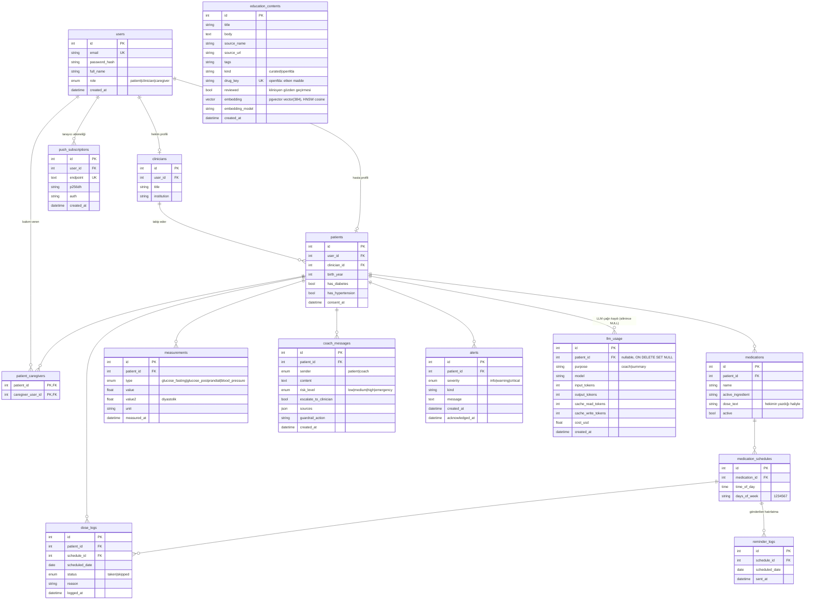

# ER Diyagramı

`dose_logs` üzerinde `(schedule_id, scheduled_date)` tekil kısıtı vardır: bir planlı doz için gün başına tek kayıt.

`reminder_logs` üzerinde `(schedule_id, scheduled_date)` tekil kısıtı vardır: bir planlı doz için gün başına en fazla bir web push hatırlatması. `push_subscriptions.endpoint` tekildir (aynı tarayıcı yeniden abone olursa kayıt güncellenir); push servisi 404/410 dönerse abonelik silinir.

`llm_usage` her Claude çağrısının (koç ve haftalık özet anlatısı) token ve tahmini USD maliyetini tutar (migration `0004_llm_usage`); mesaj içeriği saklanmaz. Günlük hasta isteği/token limiti ve aylık USD bütçesi bu tablodan hesaplanır (Redis kullanılmaz). Hasta silinirse `patient_id` NULL olur, kayıt anonim toplam olarak kalır.

`education_contents` RAG korpusudur (migration `0003_rag`): `kind='curated'` satırlar `backend/app/data/education.yaml` dosyasından seed ile başlığa göre upsert edilir; `kind='openfda'` satırlar openFDA etiketinden üretilir ve `drug_key` (etken madde) tekildir. `embedding` PostgreSQL'de pgvector `vector(384)` (HNSW, `vector_cosine_ops`), SQLite'ta (testler) JSON'dur; `embedding_model` farklıysa satır tembel olarak yeniden embed edilir.
