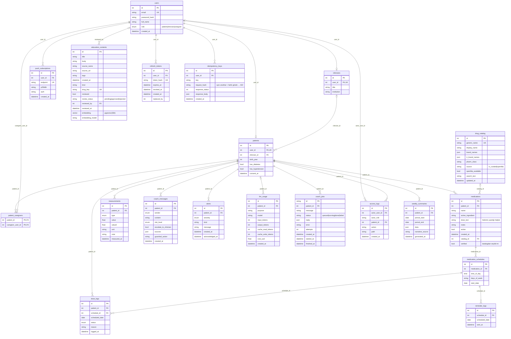

# ER Diyagramı

`dose_logs` üzerinde `(schedule_id, scheduled_date)` tekil kısıtı vardır: bir planlı doz için gün başına tek kayıt.

`reminder_logs` üzerinde `(schedule_id, scheduled_date)` tekil kısıtı vardır: bir planlı doz için gün başına en fazla bir web push hatırlatması. `push_subscriptions.endpoint` tekildir (aynı tarayıcı yeniden abone olursa kayıt güncellenir); push servisi 404/410 dönerse abonelik silinir.

`llm_usage` her Claude çağrısının (koç ve haftalık özet anlatısı) token ve tahmini USD maliyetini tutar (migration `0004_llm_usage`); mesaj içeriği saklanmaz. Günlük hasta isteği/token limiti ve aylık USD bütçesi bu tablodan hesaplanır (Redis kullanılmaz). Hasta silinirse `patient_id` NULL olur, kayıt anonim toplam olarak kalır.

`education_contents` RAG korpusudur (migration `0003_rag`): `kind='curated'` satırlar `backend/app/data/education.yaml` dosyasından seed ile başlığa göre upsert edilir; `kind='openfda'` satırlar openFDA etiketinden üretilir ve `drug_key` (etken madde) tekildir. `embedding` PostgreSQL'de pgvector `vector(384)` (HNSW, `vector_cosine_ops`), SQLite'ta (testler) JSON'dur; `embedding_model` farklıysa satır tembel olarak yeniden embed edilir.

### Sonradan eklenen tablolar ve alanlar

- `drug_catalog` (migration `0007_drug_catalog`): ilaç seçim kataloğu. `tr_curated` satırları `backend/app/data/drug_catalog_tr.yaml`'dan seed ile gelir (Türk ticari adları → etken madde); `openfda` satırları isteğe bağlı `python -m app.scripts.sync_drug_catalog` ile openFDA `count` uç noktasından çekilir. `search_text` Türkçe karakter ve büyük/küçük harf duyarsız arama içindir. `medications.catalog_id` + `medications.verified`: katalogdan seçilen ilaç doğrulanmıştır; listede olmayan ilaç `verified=false` kaydedilir ve hekim panelinde işaretlenir.
- `idempotency_keys` (migration `0008_idempotency`): `(user_id, key)` tekil. Aynı `Idempotency-Key` + aynı gövde → kayıtlı yanıt (`Idempotent-Replayed: true`); farklı gövde → 422. 24 saatten eski kayıtlar worker'daki günlük işle silinir.
- `education_contents.review_status / reviewed_by / reviewed_at` (migration `0010_education_review`): hekim onayı. Reddedilen içerik RAG'de kullanılmaz; onay bekleyen openFDA içeriği kaynakta işaretlenir (bkz. `docs/egitim-icerigi-onayi.md`).
- `weekly_summaries` (migration `0011_weekly_summaries`): her pazartesi lider worker'ın ürettiği haftalık özet; `/summaries` önce son saklanan özeti döner.
- `coach_jobs` (0005), `refresh_tokens` ve `access_logs` (0006): koç iş kuyruğu, oturum yenileme token'ları (yalnız SHA-256 özeti) ve KVKK erişim kaydı.
