# ER Diyagramı

```mermaid
erDiagram
    users ||--o| patients : "hasta profili"
    users ||--o| clinicians : "hekim profili"
    clinicians ||--o{ patients : "takip eder"
    patients ||--o{ patient_caregivers : ""
    users ||--o{ patient_caregivers : "bakım veren"
    patients ||--o{ medications : ""
    medications ||--o{ medication_schedules : ""
    medication_schedules ||--o{ dose_logs : ""
    patients ||--o{ dose_logs : ""
    patients ||--o{ measurements : ""
    patients ||--o{ coach_messages : ""
    patients ||--o{ alerts : ""
    users ||--o{ push_subscriptions : "tarayıcı aboneliği"
    medication_schedules ||--o{ reminder_logs : "gönderilen hatırlatma"
    patients ||--o{ llm_usage : "LLM çağrı kaydı (silinince NULL)"
    drug_catalog |o--o{ medications : "katalog eşleşmesi (verified)"
    patients ||--o{ coach_jobs : "asenkron koç işi / DLQ"
    patients ||--o{ weekly_summaries : "zamanlanmış haftalık özet"
    users ||--o{ refresh_tokens : "oturum"
    users |o--o{ access_logs : "erişen (silinince NULL)"
    patients ||--o{ access_logs : "erişilen"
    users ||--o{ idempotency_keys : "yazma isteği sonucu"
    users |o--o{ education_contents : "onaylayan hekim"

    users {
        int id PK
        string email UK
        string password_hash
        string full_name
        enum role "patient|clinician|caregiver"
        datetime created_at
    }
    clinicians {
        int id PK
        int user_id FK
        string title
        string institution
    }
    patients {
        int id PK
        int user_id FK
        int clinician_id FK
        int birth_year
        bool has_diabetes
        bool has_hypertension
        datetime consent_at
    }
    patient_caregivers {
        int patient_id PK,FK
        int caregiver_user_id PK,FK
    }
    medications {
        int id PK
        int patient_id FK
        string name
        string active_ingredient
        string dose_text "hekimin yazdığı haliyle"
        bool active
        int catalog_id FK "nullable"
        bool verified "katalogda var mı"
    }
    medication_schedules {
        int id PK
        int medication_id FK
        time time_of_day
        string days_of_week "1234567"
    }
    dose_logs {
        int id PK
        int patient_id FK
        int schedule_id FK
        date scheduled_date
        enum status "taken|skipped"
        string reason
        datetime logged_at
    }
    measurements {
        int id PK
        int patient_id FK
        enum type "glucose_fasting|glucose_postprandial|blood_pressure"
        float value
        float value2 "diyastolik"
        string unit
        datetime measured_at
    }
    coach_messages {
        int id PK
        int patient_id FK
        enum sender "patient|coach"
        text content
        enum risk_level "low|medium|high|emergency"
        bool escalate_to_clinician
        json sources
        string guardrail_action
        datetime created_at
    }
    alerts {
        int id PK
        int patient_id FK
        enum severity "info|warning|critical"
        string kind
        text message
        datetime created_at
        datetime acknowledged_at
    }
    push_subscriptions {
        int id PK
        int user_id FK
        text endpoint UK
        string p256dh
        string auth
        datetime created_at
    }
    reminder_logs {
        int id PK
        int schedule_id FK
        date scheduled_date
        datetime sent_at
    }
    education_contents {
        int id PK
        string title
        text body
        string source_name
        string source_url
        string tags
        string kind "curated|openfda"
        string drug_key UK "openfda: etken madde"
        bool reviewed "= review_status approved"
        string review_status "pending|approved|rejected"
        int reviewed_by_user_id FK "nullable"
        datetime reviewed_at
        text review_note
        vector embedding "pgvector vector(384), HNSW cosine"
        string embedding_model
        datetime created_at
    }
    llm_usage {
        int id PK
        int patient_id FK "nullable, ON DELETE SET NULL"
        string purpose "coach|summary"
        string model
        int input_tokens
        int output_tokens
        int cache_read_tokens
        int cache_write_tokens
        float cost_usd
        datetime created_at
    }
    drug_catalog {
        int id PK
        string generic_name UK "etken madde, küçük harf, tuzsuz"
        json brand_names "TR ticari adlar"
        string indication_group "diabetes|hypertension|other"
        string pharm_class "openFDA EPC"
        string source "curated|openfda"
        int label_count
        text search_text "Türkçe duyarsız arama"
        datetime updated_at
    }
    coach_jobs {
        string id PK "uuid"
        int patient_id FK
        text message "işlenince silinir (DLQ hariç)"
        string status "queued|running|done|failed"
        json reply
        string error
        int attempts
        datetime created_at
        datetime started_at
        datetime finished_at
        datetime dead_lettered_at "DLQ"
        string last_error "hata türü"
    }
    weekly_summaries {
        int id PK
        int patient_id FK
        date period_start "UK (patient_id, period_start)"
        date period_end
        json payload
        string narrative_source
        datetime created_at
    }
    refresh_tokens {
        int id PK
        int user_id FK
        string token_hash UK "SHA-256"
        datetime expires_at
        datetime revoked_at
        int replaced_by
        datetime created_at
    }
    access_logs {
        int id PK
        int actor_user_id FK "nullable"
        string actor_role
        int patient_id FK
        string action "read|write"
        string path
        datetime created_at
    }
    idempotency_keys {
        int id PK
        int user_id FK "UK (user_id, key)"
        string key
        string method
        string path
        string request_hash
        int status_code "NULL: işleniyor"
        text response_body
        json response_headers
        datetime created_at
    }
```

`dose_logs` üzerinde `(schedule_id, scheduled_date)` tekil kısıtı vardır: bir planlı doz için gün başına tek kayıt.

`reminder_logs` üzerinde `(schedule_id, scheduled_date)` tekil kısıtı vardır: bir planlı doz için gün başına en fazla bir web push hatırlatması. `push_subscriptions.endpoint` tekildir (aynı tarayıcı yeniden abone olursa kayıt güncellenir); push servisi 404/410 dönerse abonelik silinir.

`llm_usage` her Claude çağrısının (koç ve haftalık özet anlatısı) token ve tahmini USD maliyetini tutar (migration `0004_llm_usage`); mesaj içeriği saklanmaz. Günlük hasta isteği/token limiti ve aylık USD bütçesi bu tablodan hesaplanır (Redis kullanılmaz). Hasta silinirse `patient_id` NULL olur, kayıt anonim toplam olarak kalır.

`education_contents` RAG korpusudur (migration `0003_rag`): `kind='curated'` satırlar `backend/app/data/education.yaml` dosyasından seed ile başlığa göre upsert edilir; `kind='openfda'` satırlar openFDA etiketinden üretilir ve `drug_key` (etken madde) tekildir. `embedding` PostgreSQL'de pgvector `vector(384)` (HNSW, `vector_cosine_ops`), SQLite'ta (testler) JSON'dur; `embedding_model` farklıysa satır tembel olarak yeniden embed edilir.

`drug_catalog` (migration `0007_drug_catalog`): kürate TR ticari ad listesi (`backend/app/data/drug_catalog_tr.yaml`) ve openFDA senkronu. `medications.catalog_id` katalogdan seçilen kayıt; `verified=false` ilaç katalogda yok, hekim panelinde "Doğrulanmadı" görünür.

`idempotency_keys` (migration `0008_idempotency`): `Idempotency-Key` başlıklı yazma isteklerinin yanıtı, kullanıcı başına tekil anahtar; 24 saat sonra silinir (`docs/M2/api-platform.md`).

`education_contents.review_status` (migration `0009_education_review`): hekim onayı; `rejected` içerik RAG aramasına girmez, metin değişince yeniden `pending`.

`weekly_summaries` ve `coach_jobs.dead_lettered_at|last_error` (migration `0010_weekly_summaries`): Pazartesi 07:00 üretilen haftalık özetler ve koç işleri için ölü mektup kuyruğu (`docs/M5/dayaniklilik.md`).

`refresh_tokens` ve `access_logs` (migration `0006_security`): yenileme token'ının yalnızca SHA-256 özeti tutulur ve her kullanımda döndürülür; hekim/bakım veren bir hastanın verisine eriştiğinde yalnızca üst veri yazılır (KVKK hesap verebilirlik).
